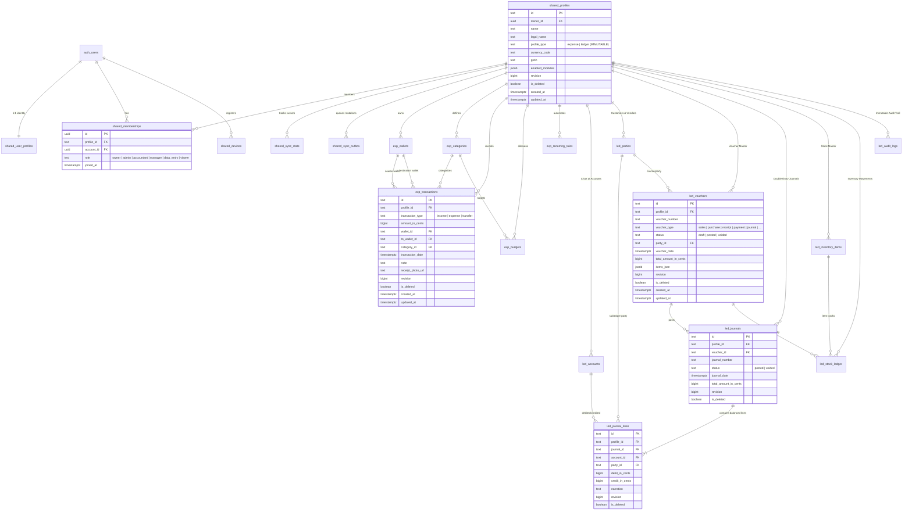

# Cloud Database ERD Specification (Supabase / PostgreSQL)

**Contract Version:** `v1.0.0-PROD-CONTRACT-20261106`  
**Status:** Approved Architectural Target (Read-Only Specification)  
**Database Engine:** PostgreSQL 15+ (Supabase)  
**Security Layer:** Row Level Security (RLS) Strictly Enforced  

---

## 1. Cloud Entity-Relationship Overview

The cloud database architecture separates global identity and workspace governance from domain-specific transaction tables. A Workspace Profile (`shared_profiles`, physically backed by `companies`) is strictly partitioned into either the **Expense** domain or the **Ledger** domain via an immutable check constraint.



---

## 2. Table Specifications & Cardinalities

### 2.1 Shared Governance Schema

#### 2.1.1 `shared_profiles` (Physical Table: `public.companies`)
*Preserves legacy table name `companies` in physical SQL storage with canonical view `shared_profiles`.*
- **Primary Key:** `id` (`TEXT`).
- **Foreign Keys:** `owner_id` $\to$ `auth.users(id) ON DELETE RESTRICT`.
- **Check Constraints:**
  - `profile_type IN ('expense', 'ledger')` (maps from legacy `mode` column).
  - `currency_code ~ '^[A-Z]{3}$'` (3-letter ISO-4217 code).
- **Profile Immutability Rule:** Enforced by PostgreSQL trigger `trg_prevent_profile_type_mutation`. Any `UPDATE` modifying `profile_type` raises an exception.
- **Indexes:**
  - `idx_companies_owner_id ON public.companies(owner_id)`
  - `idx_companies_profile_type ON public.companies(mode)`
  - `idx_companies_updated_at ON public.companies(updated_at)`

#### 2.1.2 `shared_user_profiles` (Physical Table: `public.user_profiles`)
- **Primary Key:** `id` (`UUID`, identical to `auth.users.id`).
- **Foreign Keys:** `id` $\to$ `auth.users(id) ON DELETE CASCADE`.
- **Columns:** `full_name` (`TEXT NOT NULL`), `email` (`TEXT NOT NULL`), `phone_number` (`TEXT`), `avatar_url` (`TEXT`), `preferences` (`JSONB NOT NULL DEFAULT '{}'`), `created_at` (`TIMESTAMPTZ`), `updated_at` (`TIMESTAMPTZ`).
- **Indexes:**
  - `idx_user_profiles_email ON public.user_profiles(email)`

#### 2.1.3 `shared_memberships` (New Table: `public.shared_memberships`)
- **Primary Key:** `id` (`UUID DEFAULT gen_random_uuid()`).
- **Foreign Keys:**
  - `profile_id` $\to$ `public.companies(id) ON DELETE CASCADE`.
  - `account_id` $\to$ `auth.users(id) ON DELETE CASCADE`.
- **Columns:**
  - `role` (`TEXT NOT NULL CHECK (role IN ('owner', 'admin', 'accountant', 'manager', 'data_entry', 'viewer'))`).
  - `created_at` (`TIMESTAMPTZ NOT NULL DEFAULT NOW()`).
  - `updated_at` (`TIMESTAMPTZ NOT NULL DEFAULT NOW()`).
- **Unique Constraints:** `UNIQUE (profile_id, account_id)`.
- **Indexes:**
  - `idx_memberships_account_profile ON public.shared_memberships(account_id, profile_id)`
  - `idx_memberships_profile_role ON public.shared_memberships(profile_id, role)`

#### 2.1.4 `shared_devices` (New Table: `public.shared_devices`)
- **Primary Key:** `id` (`UUID DEFAULT gen_random_uuid()`).
- **Foreign Keys:** `account_id` $\to$ `auth.users(id) ON DELETE CASCADE`.
- **Columns:**
  - `device_uuid` (`TEXT NOT NULL`).
  - `device_name` (`TEXT NOT NULL`).
  - `platform` (`TEXT NOT NULL CHECK (platform IN ('android', 'ios', 'windows', 'web', 'macos', 'linux'))`).
  - `push_token` (`TEXT`).
  - `last_sync_at` (`TIMESTAMPTZ`).
  - `is_active` (`BOOLEAN NOT NULL DEFAULT TRUE`).
- **Unique Constraints:** `UNIQUE (account_id, device_uuid)`.

---

## 3. Expense Domain Schema (Strictly Single-Entry)

All tables in the Expense domain require that the associated profile has `profile_type = 'expense'`.

### 3.1 `exp_wallets`
Represents cash accounts, bank accounts, digital wallets, or credit cards.
- **Primary Key:** `id` (`TEXT`).
- **Foreign Key:** `profile_id` $\to$ `public.companies(id) ON DELETE CASCADE`.
- **Columns:**
  - `name` (`TEXT NOT NULL`).
  - `wallet_type` (`TEXT NOT NULL CHECK (wallet_type IN ('cash', 'bank', 'credit_card', 'digital_wallet', 'savings'))`).
  - `currency_code` (`TEXT NOT NULL DEFAULT 'INR'`).
  - `starting_balance_in_cents` (`BIGINT NOT NULL DEFAULT 0`).
  - `current_balance_in_cents` (`BIGINT NOT NULL DEFAULT 0`).
  - `color_hex` (`TEXT`).
  - `icon_name` (`TEXT`).
  - `is_archived` (`BOOLEAN NOT NULL DEFAULT FALSE`).
  - `is_deleted` (`BOOLEAN NOT NULL DEFAULT FALSE`).
  - `revision` (`BIGINT NOT NULL DEFAULT 0`).
  - `created_at` / `updated_at` (`TIMESTAMPTZ NOT NULL DEFAULT NOW()`).
- **Indexes:**
  - `idx_exp_wallets_profile ON exp_wallets(profile_id) WHERE is_deleted = false`

### 3.2 `exp_categories`
Taxonomy of income and expenditure streams.
- **Primary Key:** `id` (`TEXT`).
- **Foreign Key:**
  - `profile_id` $\to$ `public.companies(id) ON DELETE CASCADE`.
  - `parent_category_id` $\to$ `exp_categories(id) ON DELETE SET NULL`.
- **Columns:**
  - `name` (`TEXT NOT NULL`).
  - `category_type` (`TEXT NOT NULL CHECK (category_type IN ('expense', 'income'))`).
  - `icon_name` (`TEXT`).
  - `color_hex` (`TEXT`).
  - `is_system` (`BOOLEAN NOT NULL DEFAULT FALSE`).
  - `is_deleted` (`BOOLEAN NOT NULL DEFAULT FALSE`).
  - `revision` (`BIGINT NOT NULL DEFAULT 0`).
  - `created_at` / `updated_at` (`TIMESTAMPTZ NOT NULL DEFAULT NOW()`).
- **Indexes:**
  - `idx_exp_categories_profile_type ON exp_categories(profile_id, category_type) WHERE is_deleted = false`

### 3.3 `exp_transactions`
The atomic financial transaction record for Expense Tracker mode.
- **Primary Key:** `id` (`TEXT`).
- **Foreign Keys:**
  - `profile_id` $\to$ `public.companies(id) ON DELETE CASCADE`.
  - `category_id` $\to$ `exp_categories(id) ON DELETE RESTRICT` (Required for income & expense).
  - `wallet_id` $\to$ `exp_wallets(id) ON DELETE RESTRICT` (Required for all).
  - `to_wallet_id` $\to$ `exp_wallets(id) ON DELETE RESTRICT` (Required only for `transfer`).
- **Columns:**
  - `transaction_type` (`TEXT NOT NULL CHECK (transaction_type IN ('expense', 'income', 'transfer'))`).
  - `amount_in_cents` (`BIGINT NOT NULL CHECK (amount_in_cents > 0)`).
  - `transaction_date` (`TIMESTAMPTZ NOT NULL`).
  - `note` (`TEXT`).
  - `payee_or_payer` (`TEXT`).
  - `reference_number` (`TEXT`).
  - `receipt_photo_url` (`TEXT`).
  - `is_cleared` (`BOOLEAN NOT NULL DEFAULT TRUE`).
  - `is_deleted` (`BOOLEAN NOT NULL DEFAULT FALSE`).
  - `revision` (`BIGINT NOT NULL DEFAULT 0`).
  - `created_at` / `updated_at` (`TIMESTAMPTZ NOT NULL DEFAULT NOW()`).
- **Check Constraints:**
  - `(transaction_type = 'transfer' AND to_wallet_id IS NOT NULL AND to_wallet_id <> wallet_id) OR (transaction_type <> 'transfer' AND to_wallet_id IS NULL)`
- **Indexes:**
  - `idx_exp_txns_profile_date ON exp_transactions(profile_id, transaction_date DESC)`
  - `idx_exp_txns_wallet ON exp_transactions(wallet_id)`
  - `idx_exp_txns_category ON exp_transactions(category_id)`
  - `idx_exp_txns_updated ON exp_transactions(profile_id, updated_at)`

### 3.4 `exp_budgets` & `exp_recurring_rules`
- `exp_budgets`: Category spending limits with rollover support.
- `exp_recurring_rules`: Autonomous transaction templates with next execution date schedule.

---

## 4. Business Ledger Domain Schema (Double-Entry Accounting)

All tables in the Ledger domain require that the associated profile has `profile_type = 'ledger'`.

### 4.1 `led_accounts` (Physical: `public.accounts`)
- **Primary Key:** `id` (`TEXT`).
- **Foreign Keys:** `company_id` $\to$ `public.companies(id) ON DELETE CASCADE`.
- **Columns:** `code` (`TEXT NOT NULL`), `name` (`TEXT NOT NULL`), `type` (`TEXT NOT NULL CHECK (type IN ('asset', 'liability', 'equity', 'income', 'expense'))`), `parent_account_id` (`TEXT`), `is_system` (`BOOLEAN`), `current_balance_in_cents` (`BIGINT`), `revision` (`BIGINT`), `is_deleted` (`BOOLEAN`).
- **Unique Constraint:** `UNIQUE (company_id, code) WHERE is_deleted = false`.

### 4.2 `led_vouchers` (Physical: `public.vouchers`)
- **Primary Key:** `id` (`TEXT`).
- **Foreign Keys:**
  - `company_id` $\to$ `public.companies(id) ON DELETE CASCADE`.
  - `party_id` $\to$ `public.parties(id) ON DELETE SET NULL`.
- **Columns:**
  - `voucher_number` (`TEXT NOT NULL`).
  - `type` (`TEXT NOT NULL CHECK (type IN ('sales', 'purchase', 'receipt', 'payment', 'contra', 'journal', 'salesOrder', 'purchaseOrder', 'estimate'))`).
  - `status` (`TEXT NOT NULL CHECK (status IN ('draft', 'posted', 'voided'))`).
  - `date` (`TIMESTAMPTZ NOT NULL`).
  - `due_date` (`TIMESTAMPTZ`).
  - `subtotal_in_cents` (`BIGINT NOT NULL DEFAULT 0`).
  - `tax_in_cents` (`BIGINT NOT NULL DEFAULT 0`).
  - `discount_in_cents` (`BIGINT NOT NULL DEFAULT 0`).
  - `total_amount_in_cents` (`BIGINT NOT NULL DEFAULT 0`).
  - `narration` (`TEXT`).
  - `items_json` (`JSONB`).
  - `revision` (`BIGINT NOT NULL DEFAULT 0`).
  - `is_deleted` (`BOOLEAN NOT NULL DEFAULT FALSE`).

### 4.3 `led_journals` & `led_journal_lines` (Physical: `public.journals`, `public.journal_lines`)
- **Invariants:**
  - Every row in `led_journals` with `status = 'posted'` MUST have associated lines in `led_journal_lines` satisfying:
    $$\sum \text{debit\_in\_cents} = \sum \text{credit\_in\_cents}$$
  - A voided voucher forces its journal status to `voided`.

### 4.4 `led_inventory_items` & `led_stock_ledger`
- Inventory master and moving-average perpetual stock movement ledger.

### 4.5 `led_audit_logs` (Physical: `public.audit_logs`)
- Tamper-evident append-only ledger with cryptographic hash chaining (`SHA-256(previous_checksum || record_data)`).

---

## 5. PostgreSQL Profile Type Immutability Trigger

```sql
CREATE OR REPLACE FUNCTION public.enforce_profile_type_immutability()
RETURNS TRIGGER AS $$
BEGIN
    IF OLD.mode IS DISTINCT FROM NEW.mode THEN
        RAISE EXCEPTION 'Profile type is immutable. Changing mode from % to % is prohibited by architectural contract v1.0.0.',
            OLD.mode, NEW.mode;
    END IF;
    RETURN NEW;
END;
$$ LANGUAGE plpgsql;

DROP TRIGGER IF EXISTS trg_prevent_profile_type_mutation ON public.companies;
CREATE TRIGGER trg_prevent_profile_type_mutation
BEFORE UPDATE ON public.companies
FOR EACH ROW
EXECUTE FUNCTION public.enforce_profile_type_immutability();
```

---
*End of Cloud Database ERD Specification (`docs/architecture/cloud-erd.md`)*

