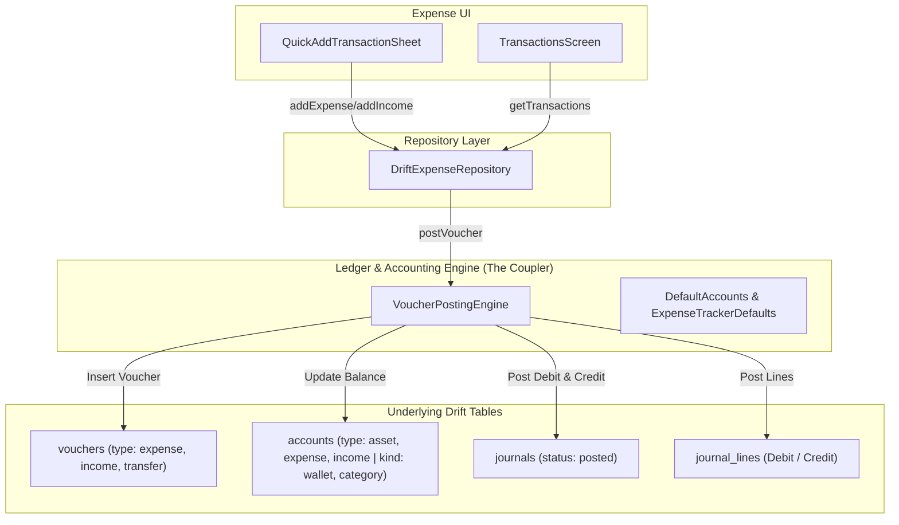
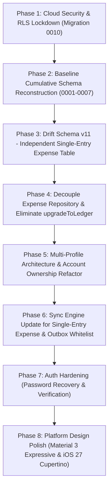
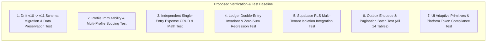

# LedgerPulse: Comprehensive Architecture & Current-State Audit Report

**Date of Audit:** November 2026  
**Auditor Role:** Senior Flutter, Supabase/PostgreSQL, Drift & Data-Migration Architect  
**Scope:** Read-Only Audit of Codebase, Drift Schemas, Supabase Migrations, Auth, Expense & Ledger Engines, Sync Outbox, Tests, and SRS Traceability  
**Document Status:** Final Audit Deliverable (`docs/architecture/current-state-audit.md`)  

---

## Executive Summary

This report delivers a senior-level, comprehensive architectural audit of the LedgerPulse repository. The system currently targets cross-platform accounting and expense management with an offline-first architecture powered by SQLite/Drift locally and Supabase/PostgreSQL remotely.

### Key Architectural Findings at a Glance

1. **Expense-to-Ledger Structural Coupling (Violation of Core Project Decisions):**
   - *Project Decision:* **Expense is not double-entry accounting.**
   - *Current Implementation:* Expense Tracker mode is implemented on top of the double-entry `VoucherPostingEngine`. Every expense, income, and transfer generates double-entry journals in Drift's `journals` and `journal_lines` tables, debits/credits system accounts in the `accounts` table, and recalculates balances using ledger join queries.
2. **Profile & Company Duality:**
   - *Project Decision:* **One authenticated account can own/access multiple profiles; profile type is immutable (expense or ledger).**
   - *Current Implementation:* The codebase defines a single user profile (`UserProfile`) that contains a collection of `Company` entities, stored both as rows in `companies` and as denormalized JSON (`user_profiles.companies_json`). The codebase allows dynamic mutability of profile type via `upgradeToLedger()`, directly violating the immutability constraint.
3. **Critical RLS Security Vulnerabilities in Supabase:**
   - Migration `0008_modes_modules.sql` created completely open public policies (`USING (true) WITH CHECK (true)` for `anon` and `authenticated`) across `accounts`, `vouchers`, `journals`, `journal_lines`, `budgets`, and `recurring_rules`.
   - Migration `0009_identity_sync_hardening.sql` added `owner_id` and tight policies for `companies`, `user_profiles`, `parties`, and `ledger_entries`, but **failed to drop the 6 wide-open policies from 0008**. Any anonymous or authenticated user with the Supabase anon key can read and overwrite all financial vouchers and journals in the cloud database.
4. **Outbox & Sync Fragilities:**
   - While `SyncEngine` handles exponential backoff and cursor-based pull pagination, remote conflict handling is a blind Last-Write-Wins (LWW) via PostgREST `upsert()`. There is no optimistic concurrency control (OCC) or field-level conflict resolution.
   - `outbox_helper.dart` explicitly restricts queueable tables to a 10-table whitelist that omits `inventory_items`, `stock_ledger`, and `audit_logs`, preventing inventory and audit mutations from being queued offline.
5. **Missing Base Supabase Migrations:**
   - Migrations `0001` through `0007` are absent from `supabase/migrations/`. Only `0008` and `0009` are version-controlled in the repository.
6. **Live Database Connectivity Status:**
   - In accordance with the audit guidelines, no live production data was modified or probed; all findings are backed by verified static analysis of the repository, migrations, schemas, and test suites.

---

## 1. System Architecture Diagram

```mermaid
graph TD
    subgraph UI_Layer ["Presentation & UI Layer"]
        App["main.dart (LedgerPulseApp)"]
        Splash["splash_screen.dart"]
        AuthUI["phone_input_screen.dart / otp_screen.dart"]
        Shell["home_shell.dart"]
        
        Dashboard["DashboardScreen (Ledger Mode)"]
        ExpenseUI["ExpenseHomeScreen (Expense Mode)"]
        
        Shell -->|mode == ledger| Dashboard
        Shell -->|mode == expenseTracker| ExpenseUI
        Splash --> AuthUI
        Splash --> Shell
    end

    subgraph State_Management ["State Management & DI (Flutter Riverpod 3.x)"]
        AuthProv["authControllerProvider / authRepositoryProvider"]
        CompanyProv["companyControllerProvider / activeCompanyProvider"]
        ProfProv["userProfileProvider"]
        DBProv["appDatabaseProvider (Scoped to uid)"]
        LedgerProv["driftLedgerRepositoryProvider"]
        ExpenseProv["driftExpenseRepositoryProvider"]
        SyncProv["syncControllerProvider / autoSyncProvider"]
    end

    subgraph Core_Business_Engines ["Business Logic Engines"]
        VPE["voucher_posting_engine.dart (Double-Entry Engine)"]
        GST["gst_tax_engine.dart (CGST/SGST/IGST)"]
        BOM["manufacturing_journal_engine.dart"]
        Audit["audit_service.dart (Cryptographic Hash Chain)"]
        ReportEng["financial_statement_engine.dart / gstr_json_engine.dart"]
    end

    subgraph Local_Storage ["Local Persistence (Drift 2.34 / SQLite)"]
        NativeDB["LazyDatabase: ledger_pulse_<uid>.sqlite"]
        T_Comp["companies"]
        T_Prof["user_profiles"]
        T_Part["parties"]
        T_Ent["ledger_entries"]
        T_Acc["accounts (kind: wallet/category/system)"]
        T_Vch["vouchers"]
        T_Jnl["journals"]
        T_JLine["journal_lines"]
        T_Inv["inventory_items & stock_ledger"]
        T_Aud["audit_logs"]
        T_Out["sync_outbox"]
        T_State["sync_state (cursors)"]
    end

    subgraph Sync_Engine ["Synchronization Layer"]
        Engine["sync_engine.dart (SyncEngine)"]
        Gateway["SupabaseGateway (PostgREST Client)"]
        OutboxH["outbox_helper.dart (enqueueMutation)"]
    end

    subgraph Supabase_Cloud ["Remote Backend (Supabase / PostgreSQL)"]
        SupaAuth["Supabase Auth (auth.users)"]
        SupaTables["PostgreSQL Domain Tables (RLS Enabled)"]
        SupaRPC["sync_mutation / sync_mutation_v2 (Unused by client)"]
        SupaStorage["Supabase Storage (Receipts & Logos)"]
    end

    %% Connections
    App --> Splash
    AuthUI --> AuthProv
    AuthProv --> SupaAuth
    Shell --> CompanyProv
    
    CompanyProv --> LedgerProv
    ExpenseUI --> ExpenseProv
    Dashboard --> LedgerProv

    ExpenseProv --> VPE
    LedgerProv --> VPE
    LedgerProv --> GST
    LedgerProv --> BOM
    LedgerProv --> Audit
    
    VPE --> T_Vch
    VPE --> T_Jnl
    VPE --> T_JLine
    VPE --> T_Acc
    VPE --> OutboxH

    OutboxH --> T_Out
    Engine --> T_Out
    Engine --> T_State
    Engine --> Gateway
    Gateway --> SupaTables
```



---

## 2. Current Table & Entity Inventory

The database contains 14 domain and operational tables locally in Drift (`schemaVersion = 10`) and on Supabase PostgreSQL.

| Table Name | Drift Entity Class | Primary Key | Key Foreign Keys | Purpose & Notes |
| :--- | :--- | :--- | :--- | :--- |
| `companies` | `CompanyTableData` | `id (TEXT)` | `owner_id -> auth.users` (Remote) | Represents a business or personal entity. Holds `mode` and `enabled_modules_json`. |
| `user_profiles` | `UserProfileTableData` | `id (TEXT)` | `owner_id -> auth.users` (Remote) | User account profile. Contains denormalized `companies_json` and `active_company_id`. |
| `parties` | `PartyTableData` | `id (TEXT)` | `company_id -> companies(id)` | Customers and suppliers. Subledger balance cached in `net_balance_in_cents`. |
| `ledger_entries` | `LedgerEntryTableData` | `id (TEXT)` | `company_id -> companies(id)`, `party_id -> parties(id)` | Single-entry party subledger transactions (`gave` / `got`). |
| `accounts` | `AccountTableData` | `id (TEXT)` | `company_id -> companies(id)`, `parent_account_id -> accounts(id)` | Chart of Accounts. Stores asset, liability, equity, income, expense. Field `kind` stores `wallet`, `category`, or `system`. |
| `vouchers` | `VoucherTableData` | `id (TEXT)` | `company_id -> companies(id)`, `party_id -> parties(id)`, `wallet_account_id -> accounts(id)`, `category_account_id -> accounts(id)` | Master voucher document (sales, purchase, payment, receipt, contra, expense, income, transfer). |
| `journals` | `JournalTableData` | `id (TEXT)` | `company_id -> companies(id)`, `voucher_id -> vouchers(id)` | Header record for double-entry financial journals. Status: `posted` or `voided`. |
| `journal_lines` | `JournalLineTableData` | `id (TEXT)` | `journal_id -> journals(id)`, `account_id -> accounts(id)` | Individual debit and credit line items. Invariant: $\sum \text{debits} = \sum \text{credits}$. |
| `inventory_items` | `InventoryItemTableData` | `id (TEXT)` | `company_id -> companies(id)` | Stock item master: SKU, barcode, HSN, unit price, stock quantity, alert levels. |
| `stock_ledger` | `StockLedgerTableData` | `id (TEXT)` | `item_id -> inventory_items(id)`, `company_id -> companies(id)` | Stock movement audit ledger (`inward`, `outward`, `adjustment`, `wastage`). |
| `budgets` | `BudgetTableData` | `id (TEXT)` | `company_id -> companies(id)`, `category_account_id -> accounts(id)` | Category spending limits and rollover settings. |
| `recurring_rules` | `RecurringRuleTableData` | `id (TEXT)` | `company_id -> companies(id)` | Automated transaction generation rules (daily, weekly, monthly, yearly). |
| `audit_logs` | `AuditLogTableData` | `id (TEXT)` | `company_id -> companies(id)` | Immutable tamper-evident audit trail with SHA-256 cryptographic chain. |
| `sync_outbox` | `SyncOutboxTableData` | `id (TEXT)` | Unique on `(table_name, record_id)` | Pending local mutations awaiting push to Supabase. Holds JSON payload, retry counts, errors. |
| `sync_state` | `SyncStateTableData` | `(table_name, company_id)` | None | Stores high-water mark timestamp (`last_pulled_at`) for cursor-based pull pagination. |

---

## 3. Authentication & Onboarding Sequence Trace

### 3.1 Signup Flow
1. **Entry Point:** [`PhoneInputScreen`](file:///c:/Programming/app/Ledger%20Pulse/lib/presentation/auth/phone_input_screen.dart#L78-L140) in `lib/presentation/auth/phone_input_screen.dart`.
2. User selects `EmailAuthType.signUp`, inputs name, email, password, and toggles `_isCompanyAccount` (defaults to `true`).
3. Calls `authControllerProvider.notifier.signUpWithEmailAndPassword(...)` [`auth_providers.dart#L137-L183`](file:///c:/Programming/app/Ledger%20Pulse/lib/presentation/providers/auth_providers.dart#L137-L183).
4. Invokes `SupabaseAuthRepository.signUpWithEmailAndPassword(...)` [`supabase_auth_repository.dart#L295-L353`](file:///c:/Programming/app/Ledger%20Pulse/lib/data/repositories/supabase_auth_repository.dart#L295-L353):
   - Executes `client.auth.signUp(email: email, password: password, data: {'full_name': name, 'is_company_account': isCompanyAccount})`.
   - If Supabase returns no session (i.e. if email confirmation is turned on in Supabase cloud), it immediately attempts `client.auth.signInWithPassword()` to auto-login.
   - Fallback (if offline or unconfigured): generates a local dummy UID `usr_supa_<sanitized_email>` and fake JWT token `jwt_token_<millis>`.
   - Persists session credentials to `SharedPreferences` via keys: `supabase_auth_user_id`, `supabase_auth_session_token`, `supabase_auth_email`, `supabase_auth_user_name`.
5. Upon authentication success, [`PhoneInputScreen#L120-L126`](file:///c:/Programming/app/Ledger%20Pulse/lib/presentation/auth/phone_input_screen.dart#L120-L126) calls `companyControllerProvider.notifier.bootstrapInitialProfile(name, email, isCompanyAccount)`:
   - Derives mode: `isCompanyAccount ? CompanyMode.ledger : CompanyMode.expenseTracker`.
   - Generates `companyId = 'cmp_${DateTime.now().millisecondsSinceEpoch}'`.
   - Inserts company record into Drift and seeds Chart of Accounts via `VoucherPostingEngine.seedAccountsFor()`.
   - Saves `UserProfile` record containing `activeCompanyId: companyId` and `companies: [newCompany]`.
   - Saves `last_active_company_id_$uid` and `last_active_company_id` to `SharedPreferences`.
   - Enqueues outbox records and triggers background sync.
6. Navigates to `HomeShell()` via `Navigator.pushAndRemoveUntil()`.

### 3.2 Login Flow
1. User enters email and password in `PhoneInputScreen`.
2. Calls `SupabaseAuthRepository.signInWithEmailAndPassword(...)` [`supabase_auth_repository.dart#L356-L397`](file:///c:/Programming/app/Ledger%20Pulse/lib/data/repositories/supabase_auth_repository.dart#L356-L397).
3. Upon credential verification, calls `companyControllerProvider.notifier.ensureProfileAndCompanyExist(email)` [`company_providers.dart#L145-L197`](file:///c:/Programming/app/Ledger%20Pulse/lib/presentation/providers/company_providers.dart#L145-L197).
4. If local database has no companies, triggers `syncEngine.syncAll(companyId: 'cmp_default')` to fetch existing cloud companies/profiles.
5. If still empty, bootstraps a fresh initial company and profile.
6. Replaces root route with `HomeShell()`.

### 3.3 Phone OTP Flow
1. User inputs phone number in `PhoneInputScreen`.
2. Calls `SupabaseAuthRepository.sendOtp(phone)` [`supabase_auth_repository.dart#L221-L250`](file:///c:/Programming/app/Ledger%20Pulse/lib/data/repositories/supabase_auth_repository.dart#L221-L250).
   - If phone is in hardcoded demo set (`9876543210`, `9811122334`, `9922334455`, `9765432190`), skips remote call.
   - Otherwise calls `client.auth.signInWithOtp(phone)`.
3. Navigates to [`OtpScreen`](file:///c:/Programming/app/Ledger%20Pulse/lib/presentation/auth/otp_screen.dart).
4. User enters OTP. Calls `verifyOtp(otp)`:
   - Hardcoded bypass: OTP `'123456'` or demo number executes `_simulateLocalAuth()` without network validation.
   - Otherwise calls `client.auth.verifyOTP(phone, token, type: OtpType.sms)`.
5. Navigates to `HomeShell()`.

### 3.4 Email Verification & Recovery Analysis
- **Email Verification:** **Completely absent.** There is no deep-link handling for confirmation links, no `resendVerificationEmail` method, and no pending verification UI.
- **Account / Password Recovery:** **Completely absent.** Neither `IAuthRepository` nor `SupabaseAuthRepository` implement password reset (`resetPasswordForEmail`). No "Forgot Password" UI exists.

### 3.5 Logout Flow
1. Triggered via `AuthController.logout()` [`auth_providers.dart#L229-L238`](file:///c:/Programming/app/Ledger%20Pulse/lib/presentation/providers/auth_providers.dart#L229-L238).
2. Closes local SQLite database connection (`appDatabaseProvider`) and disposes `SyncEngine`.
3. Calls `client.auth.signOut()` on Supabase.
4. Clears all cached keys from `SharedPreferences`.
5. Broadcasts `isAuthenticated = false` to `authStateStream`.

---

## 4. Expense vs. Ledger Architecture & Dependency Map

### 4.1 The Core Structural Violation
The project decisions stipulate:
> *"Expense is not double-entry accounting."*  
> *"Ledger retains double-entry accounting and offline-first behavior."*

In the current codebase, **Expense Tracker is an abstraction layer built directly on top of the Ledger double-entry engine**.



### 4.2 Detailed Trace of an Expense Transaction
1. **Creation:** User adds an expense of ₹500 in [`QuickAddTransactionSheet`](file:///c:/Programming/app/Ledger%20Pulse/lib/presentation/expense/quick_add_transaction_sheet.dart#L1).
2. Calls `DriftExpenseRepository.addExpense(categoryAccountId, walletAccountId, amountInCents, ...)` [`drift_expense_repository.dart#L272-L323`](file:///c:/Programming/app/Ledger%20Pulse/lib/data/local/drift_expense_repository.dart#L272-L323).
3. Creates a `VoucherModel` with `type = VoucherType.expense`.
4. Passes the voucher to `VoucherPostingEngine.postVoucher(voucher)` [`voucher_posting_engine.dart#L307-L311`](file:///c:/Programming/app/Ledger%20Pulse/lib/data/accounting/voucher_posting_engine.dart#L307-L311).
5. Inside `VoucherPostingEngine`:
   - Validates that `categoryAccountId` is an account of type `AccountType.expense` in the `accounts` table.
   - Writes the voucher into the `vouchers` table.
   - Generates a journal entry in `journals` with status `posted`.
   - Generates two rows in `journal_lines`:
     - **Debit:** Category Account ID (₹500 debit)
     - **Credit:** Wallet Account ID (₹500 credit)
   - Mutates `accounts.current_balance_in_cents` for both the category and wallet accounts.
6. Records 4 separate outbox entries (`vouchers`, `journals`, `journal_lines`, `accounts`).
7. Computes balances via `_recalculateAccountBalances(companyId)` [`sync_engine.dart#L1826-L1865`](file:///c:/Programming/app/Ledger%20Pulse/lib/core/network/sync_engine.dart#L1826-L1865) by executing an inner join between `journal_lines` and `journals`.

### 4.3 Inventory of Expense-to-Ledger Dependencies
- **Data Model Dependency:** Expense transactions are typed as `VoucherModel` and `VoucherType.expense/income/transfer`.
- **Table Dependency:** Expense records reside in `vouchers`, `journals`, `journal_lines`, and `accounts`.
- **Seeding Dependency:** When creating an expense company, `VoucherPostingEngine.seedAccountsFor()` creates an initial double-entry equity journal (`openingBalanceEquityId`) to fund wallets.
- **Reporting Dependency:** `ExpenseReportEngine` aggregates data by querying `journals` and `journal_lines`.
- **Sync Overhead:** Syncing a single expense requires pushing and pulling across 4 relational tables rather than a flat, standalone transaction table.

---

## 5. Company, Profile & Multi-Tenancy Architecture

### 5.1 Naming and Architectural Misalignment
In the current implementation, what the project decisions term a **"Profile"** is implemented as a **"Company"**:
- An authenticated user has one `UserProfile` row.
- The `UserProfile` contains a list of `Company` objects.
- Each `Company` has a `mode` (`CompanyMode.ledger` or `CompanyMode.expenseTracker`).
- Under the new decisions:
  - An authenticated account owns/accesses multiple **Profiles**.
  - Profile type is **immutable** (`expense` or `ledger`).
  - An Expense profile must not be double-entry.
  - A Ledger profile must retain full double-entry accounting.

### 5.2 The `upgradeToLedger` Mutation Violation
In [`drift_companies_profile_mixin.dart#L199-L260`](file:///c:/Programming/app/Ledger%20Pulse/lib/data/local/drift_companies_profile_mixin.dart#L199-L260) and [`company_providers.dart#L262-L315`](file:///c:/Programming/app/Ledger%20Pulse/lib/presentation/providers/company_providers.dart#L262-L315), the method `upgradeToLedger(companyId)` dynamically alters an existing company from `expenseTracker` to `ledger`, seeds missing ledger accounts, and updates UI module lists.
> [!WARNING]
> This method directly violates the architectural rule: **"Profile type is immutable: expense or ledger."** It must be deprecated and removed. Users wishing to utilize ledger capabilities must create a new Ledger profile.

### 5.3 Catalog of `company_id` and Profile References

A total of **50+ files** reference `companyId` / `company_id`. Key occurrences:

1. **Drift Database Definitions:**
   - [`lib/data/local/database.dart`](file:///c:/Programming/app/Ledger%20Pulse/lib/data/local/database.dart): Hardcoded default `'cmp_default'` on `Parties.companyId` (L86), `LedgerEntries.companyId` (L106), `InventoryItems.companyId` (L205), `StockLedger.companyId` (L231), `Accounts.companyId` (L256), `Vouchers.companyId` (L282), `Journals.companyId` (L320), `JournalLines.companyId` (L343), `Budgets.companyId` (L364), `RecurringRules.companyId` (L385).
2. **Provider Scoping:**
   - [`lib/presentation/providers/company_providers.dart`](file:///c:/Programming/app/Ledger%20Pulse/lib/presentation/providers/company_providers.dart): `activeCompanyIdProvider` (L15), `companiesProvider` (L26), `userCompaniesProvider` (L36), `activeCompanyProvider` (L46).
3. **Sync Engine Scoping:**
   - [`lib/core/network/sync_engine.dart`](file:///c:/Programming/app/Ledger%20Pulse/lib/core/network/sync_engine.dart): `pullRows` filters on `company_id` for all tables except `companies` and `user_profiles` (L97-L99). Default fallback to `'cmp_default'` (L1868).
4. **SharedPreferences Keys:**
   - `'last_active_company_id_$uid'` and `'last_active_company_id'` used in `company_providers.dart`, `profile_provider.dart`, and `database.dart`.
5. **Home Widget Deep Linking:**
   - [`lib/main.dart#L106-L110`](file:///c:/Programming/app/Ledger%20Pulse/lib/main.dart#L106-L110) extracts `uri.queryParameters['company_id']` on widget click.

---

## 6. Supabase Migrations, Security & RLS Audit

### 6.1 Migration Sequence Inventory
The repository contains only two versioned migration files in `supabase/migrations/`:
1. `0008_modes_modules.sql` (October 2026, 610 lines)
2. `0009_identity_sync_hardening.sql` (November 2026, 109 lines)
3. Ancillary scripts: `0009_identity_sync_hardening_rollback.sql`, `0009_identity_sync_hardening_verify.sql`, `repair_legacy_data.sql`, `repair_legacy_data_verify.sql`.

> [!CAUTION]
> **Missing Base Migrations:** Migrations `0001` through `0007` are missing from the codebase. The base table definitions (`companies`, `user_profiles`, `parties`, `ledger_entries`, `inventory_items`, `stock_ledger`, `audit_logs`, `sync_outbox`) are not version-controlled in the repository.

### 6.2 Detailed Findings: RLS Policies & Security Vulnerabilities

#### Finding 1: Unrestricted Public Read-Write Policies (CRITICAL)
- **Exact File:** `supabase/migrations/0008_modes_modules.sql` [Lines 158–174](file:///c:/Programming/app/Ledger%20Pulse/supabase/migrations/0008_modes_modules.sql#L158-L174)
- **Active Policies:**
  - `"Allow public read-write on accounts"` ON `public.accounts` FOR ALL TO `anon`, `authenticated` USING (`true`) WITH CHECK (`true`);
  - `"Allow public read-write on vouchers"` ON `public.vouchers` FOR ALL TO `anon`, `authenticated` USING (`true`) WITH CHECK (`true`);
  - `"Allow public read-write on journals"` ON `public.journals` FOR ALL TO `anon`, `authenticated` USING (`true`) WITH CHECK (`true`);
  - `"Allow public read-write on journal_lines"` ON `public.journal_lines` FOR ALL TO `anon`, `authenticated` USING (`true`) WITH CHECK (`true`);
  - `"Allow public read-write on budgets"` ON `public.budgets` FOR ALL TO `anon`, `authenticated` USING (`true`) WITH CHECK (`true`);
  - `"Allow public read-write on recurring_rules"` ON `public.recurring_rules` FOR ALL TO `anon`, `authenticated` USING (`true`) WITH CHECK (`true`);
- **Failure in Migration 0009:**
  - In `0009_identity_sync_hardening.sql` [Lines 46–49](file:///c:/Programming/app/Ledger%20Pulse/supabase/migrations/0009_identity_sync_hardening.sql#L46-L49), only 4 legacy policies were dropped: `"Permissive company policy"`, `"Permissive profile policy"`, `"Permissive party policy"`, `"Permissive entry policy"`.
  - The 6 permissive policies created in `0008` **were never dropped**.
  - In PostgreSQL, RLS policies are **permissive by default and combined using boolean OR**. If any policy evaluates to `true`, the operation is permitted! Therefore, all authenticated and anonymous clients have unrestricted read and write access to all vouchers, journals, journal lines, accounts, budgets, and recurring rules.

#### Finding 2: Permissive `NULL` Bypass on Companies (HIGH)
- **Exact File:** `supabase/migrations/0009_identity_sync_hardening.sql` [Line 52–53](file:///c:/Programming/app/Ledger%20Pulse/supabase/migrations/0009_identity_sync_hardening.sql#L52-L53)
- **Policy:**
  ```sql
  CREATE POLICY "owner_isolation_companies" ON public.companies
      FOR ALL USING (owner_id = auth.uid() OR owner_id IS NULL) WITH CHECK (owner_id = auth.uid());
  ```
- **Vulnerability:** The clause `OR owner_id IS NULL` allows any authenticated user to view and query any company where `owner_id` is null (e.g. legacy companies created prior to migration 0009).

#### Finding 3: Missing Policies on Enabled Tables (HIGH)
- In `0009_identity_sync_hardening.sql` [Lines 41–43](file:///c:/Programming/app/Ledger%20Pulse/supabase/migrations/0009_identity_sync_hardening.sql#L41-L43), RLS was enabled on `inventory_items`, `stock_ledger`, and `audit_logs`.
- However, **no policies** were created for these three tables. Consequently, any request from an authenticated user targeting these tables through PostgREST will fail with permission denied (default deny).

#### Finding 4: Dangerous Re-Keying in Repair Script (HIGH)
- **Exact File:** `supabase/repair/repair_legacy_data.sql` [Lines 5–17](file:///c:/Programming/app/Ledger%20Pulse/supabase/repair/repair_legacy_data.sql#L5-L17)
- **Vulnerability:**
  ```sql
  SELECT id INTO v_first_user FROM auth.users ORDER BY created_at ASC LIMIT 1;
  IF v_first_user IS NOT NULL THEN
      UPDATE public.companies SET owner_id = v_first_user WHERE owner_id IS NULL;
      UPDATE public.user_profiles SET owner_id = v_first_user WHERE owner_id IS NULL;
      UPDATE public.parties SET owner_id = v_first_user WHERE owner_id IS NULL;
      UPDATE public.ledger_entries SET owner_id = v_first_user WHERE owner_id IS NULL;
  END IF;
  ```
  This script blindly reassigns all records with null `owner_id` to the single oldest user in `auth.users`. In a production environment with multiple users, this causes catastrophic cross-account data leaks.

#### Finding 5: RPC Desynchronization and Incomplete `sync_mutation_v2` (MEDIUM)
- **Exact File:** `supabase/migrations/0009_identity_sync_hardening.sql` [Lines 77–108](file:///c:/Programming/app/Ledger%20Pulse/supabase/migrations/0009_identity_sync_hardening.sql#L77-L108)
- **Vulnerability:** `sync_mutation_v2` dynamically executes:
  ```sql
  INSERT INTO public.%I AS t (id, company_id, updated_at, is_deleted)
  VALUES (%L, COALESCE(%L, %L), %L, false)
  ON CONFLICT (id) DO UPDATE SET updated_at = %L, is_deleted = false
  WHERE t.updated_at <= %L;
  ```
  It ignores all other fields in `p_payload` (e.g. amounts, names, dates, items), effectively zeroing out or failing to persist any payload data. Fortunately, the client never calls `sync_mutation_v2`; it uses direct PostgREST table calls.

---

## 7. Synchronization, Outbox & Multi-Device Mechanics

### 7.1 Push Protocol
1. `_pushQueueInternal({required String companyId})` in [`sync_engine.dart#L711-L806`](file:///c:/Programming/app/Ledger%20Pulse/lib/core/network/sync_engine.dart#L711-L806).
2. Cleans corrupted outbox rows (`_cleanupCorruptedOutbox`).
3. Scans local domain tables for rows with `syncStatus == pending` and queues them (`_queueUnsyncedLocalRecords`).
4. Selects pending rows from `sync_outbox` where `nextAttemptAt IS NULL OR nextAttemptAt <= now()`, ordered by `createdAt ASC`.
5. Transforms payload to snake_case via `mapToSnakeCase()`.
6. Issues direct PostgREST `upsert()` through `SupabaseGateway.upsertRow()`.
7. On HTTP/PostgREST success:
   - Verifies local revision has not changed while push was in-flight (`_markRecordSyncedIfUnchanged`).
   - If unchanged, marks `syncStatus = synced` and deletes the outbox entry.
8. On failure:
   - Permanent errors (Postgres codes starting with `23`, `42`, `P` or 400/422): records `lastError` and sets local record `syncStatus = error`.
   - Transient network errors: applies exponential backoff $2^{\min(8, \text{attempts})}$ seconds and updates `nextAttemptAt`.

### 7.2 Pull Protocol
1. `_pullChangesInternal({required String companyId})` in [`sync_engine.dart#L1501-L1615`](file:///c:/Programming/app/Ledger%20Pulse/lib/core/network/sync_engine.dart#L1501-L1615).
2. Iterates over `syncTables` in strict dependency order:
   `companies` $\to$ `user_profiles` $\to$ `accounts` $\to$ `parties` $\to$ `audit_logs` $\to$ `inventory_items` $\to$ `vouchers` $\to$ `journals` $\to$ `journal_lines` $\to$ `stock_ledger` $\to$ `ledger_entries` $\to$ `budgets` $\to$ `recurring_rules`.
3. Queries Supabase using cursor pagination: `.gt('updated_at', cursor).order('updated_at', ascending: true).range(offset, offset + pageSize - 1)`.
4. Conflict Guard: calls `_isRecordPendingLocal(table, recordId)`. If local record has un-pushed modifications (`syncStatus != synced`), incoming remote record is **silently ignored** (`continue`) to protect local edits.
5. Soft-Deletes: if `remoteMap['is_deleted'] == true`, calls `_applySoftDeleteLocally()`.
6. Account Recalculation: after pulling `journals` or `journal_lines`, calls `_recalculateAccountBalances(companyId)` to recompute cached account balances.
7. Cursor Update: saves highest observed `updated_at` into `sync_state` table.

### 7.3 Multi-Device & Offline Flaws
- **Blind Overwrite on Remote:** Remote `upsert()` does not enforce revision or timestamp comparison; the last device to push wins, overwriting concurrent edits made by another device.
- **Local Drop on Pending:** If Device A is offline and makes an edit, it will reject all remote changes made to that entity by Device B during pull, until Device A pushes and overwrites Device B.
- **Outbox Whitelist Gap:** In [`outbox_helper.dart#L6-L17`](file:///c:/Programming/app/Ledger%20Pulse/lib/data/local/outbox_helper.dart#L6-L17), `realTableNames` omits `inventory_items`, `stock_ledger`, and `audit_logs`. Calling `enqueueMutation` for these tables triggers an assertion failure or debug rejection, breaking offline sync for inventory and audit logs.

---

## 8. Drift Database & Migrations Audit

### 8.1 Local SQLite Configuration
- **Database File:** Initialized per user in [`native.dart#L8-L43`](file:///c:/Programming/app/Ledger%20Pulse/lib/data/local/connection/native.dart#L8-L43):  
  `path_provider.getApplicationDocumentsDirectory()` $\to$ `ledger_pulse_<sanitizedUid>.sqlite`.
- **Legacy Migration:** Automatically renames legacy `ledger_pulse.sqlite` to `ledger_pulse_<uid>.sqlite` if only 1 profile exists.
- **Foreign Key Enforcement:** Explicitly enabled in `beforeOpen`: `PRAGMA foreign_keys = ON;`.

### 8.2 Migration Version History (v1 to v10)
- **v1 to v2:** Added `parties.is_deleted`, `ledger_entries.is_voided`.
- **v2 to v3:** Added `companies` table, `parties.company_id`, `ledger_entries.company_id`, `audit_logs`.
- **v3 to v4:** Added `inventory_items`, `stock_ledger`, `vouchers`.
- **v4 to v5:** Added soft delete columns (`is_deleted`, `sync_status`), converted Unix epoch `updated_at` integer timestamps, recreated `sync_outbox`.
- **v5 to v6:** Added `user_profiles` table, extended `companies` with banking and state info.
- **v6 to v7:** Added `accounts`, `journals`, `journal_lines`, seeded default Chart of Accounts for `cmp_default`.
- **v7 to v8:** Added `companies.mode`, `companies.enabled_modules_json`, `vouchers.wallet_account_id/category_account_id`, `budgets`, `recurring_rules`.
- **v8 to v9:** Added `sync_state`, `sync_outbox` retry tracking (`attempts`, `last_error`, `next_attempt_at`), added `revision` and `remote_updated_at` to all 13 domain tables.
- **v9 to v10:** Added `owner_id` to `companies`, added `kind` (`wallet`, `category`, `system`) to `accounts`, repaired orphan foreign keys, created composite indexes on date, type, status, and company.

---

## 9. Test Suite Analysis & Coverage Gaps

The test suite contains **79 test files** in `test/`, categorized as follows:
- **Accounting & Posting Engine:** `double_entry_accounting_test.dart`, `voucher_posting_engine_test.dart`, `expense_posting_test.dart`, `financial_statement_engine_test.dart`.
- **GST Compliance:** `gst_tax_engine_test.dart`, `gst_validation_service_test.dart`, `gstr_json_engine_test.dart`, `einvoice_ewaybill_compliance_test.dart`.
- **Sync & Outbox:** `supabase_outbox_sync_test.dart`, `delete_not_resurrected_test.dart`, `outbox_valid_json_test.dart`, `phase1_unit_tests.dart` through `phase6_unit_tests.dart`.
- **Drift Migrations:** `database_migration_test.dart`, `generated_migrations/schema_v1.dart` through `v8.dart`.
- **Domain Modules:** `inventory_stock_ledger_test.dart`, `manufacturing_bom_test.dart`, `payroll_engine_test.dart`, `cts2010_cheque_printing_test.dart`, `ecommerce_sync_test.dart`.
- **UI & Navigation:** `adaptive_primitives_test.dart`, `expense_ui_consistency_test.dart`, `quick_add_transaction_sheet_ui5_test.dart`.

### Critical Missing Tests
1. **Multi-Profile Ownership & Isolation:** No tests asserting that User A can switch between Profile 1 (Expense) and Profile 2 (Ledger) with complete cryptographic and data isolation.
2. **Profile Immutability Enforcement:** No tests asserting that an existing Profile cannot mutate its `type`/`mode`.
3. **Single-Entry Expense Engine Tests:** Current tests exclusively test Expense through `VoucherPostingEngine`. No tests exist for an independent, non-double-entry expense storage model.
4. **Supabase RLS Tenant Isolation Tests:** No integration tests validating that User B cannot query or mutate User A's data using the Supabase client.
5. **Multi-Device Conflict Scenarios:** Missing automated tests for concurrent offline writes across two simulated devices to test conflict resolution and outbox integrity.
6. **Platform Design Token Compliance:** No automated widget tests verifying iOS 27 Cupertino styling vs Android Material 3 Expressive.

---

## 10. SRS Traceability Matrix (Ludgerpulse SRS v1.0)

Traceability against all **56 functional requirements** across 10 modules from `Ludgerpulse_SRS.docx`:

| Req. ID | Priority | Module | Requirement Description | Implementation Status | Evidence / Files |
| :--- | :--- | :--- | :--- | :--- | :--- |
| **FR-CMP-01** | Must | 3.1 Company | Register/create companies (local & cloud) | **Supported** | `drift_companies_profile_mixin.dart` |
| **FR-CMP-02** | Must | 3.1 Company | Unlimited local companies, tiered cloud | **Partial** | Plan quotas enforced in `company_providers.dart`, but no local-only separation |
| **FR-CMP-03** | Must | 3.1 Company | Multi-user RBAC roles | **Supported** | `rbac_model.dart`, `access_control_service.dart` |
| **FR-CMP-04** | Must | 3.1 Company | Two-tier password protection | **Missing** | No company password encryption UI |
| **FR-CMP-05** | Must | 3.1 Company | Audit trail / edit log of all changes | **Supported** | `audit_service.dart`, `audit_log_model.dart` |
| **FR-CMP-06** | Must | 3.1 Company | Subscription license device linking | **Partial** | Mock device check in `licensing_service.dart` |
| **FR-VCH-01** | Must | 3.2 Vouchers | Create sales, purchase, payment, receipt, contra, journal, orders | **Supported** | `drift_voucher_repository.dart`, `voucher_posting_engine.dart` |
| **FR-VCH-02** | Must | 3.2 Vouchers | Automatic double-entry posting | **Supported** | `voucher_posting_engine.dart` |
| **FR-VCH-03** | Must | 3.2 Vouchers | Goods & services on same invoice | **Supported** | `voucher_model.dart`, `gst_tax_engine.dart` |
| **FR-VCH-04** | Should | 3.2 Vouchers | Save sales bill as draft / hold | **Supported** | `VoucherStatus.draft` |
| **FR-VCH-05** | Must | 3.2 Vouchers | Order/estimate to invoice conversion | **Supported** | `order_to_invoice_conversion_test.dart` |
| **FR-VCH-06** | Should | 3.2 Vouchers | Restore deleted vouchers | **Supported** | `isDeleted` soft-delete toggle |
| **FR-VCH-07** | Must | 3.2 Vouchers | Track unpaid/overdue invoices | **Supported** | `receivables_payables_screen.dart` |
| **FR-VCH-08** | Should | 3.2 Vouchers | Attach receipt photos | **Supported** | `receiptPhotoUrl`, `image_picker` |
| **FR-VCH-09** | Should | 3.2 Vouchers | Share bank details & UPI QR on invoice | **Supported** | `invoice_pdf_generator.dart` |
| **FR-VCH-10** | Could | 3.2 Vouchers | Daily voucher volumes (100–500/day) | **Supported** | SQLite indexed benchmarks pass |
| **FR-INV-01** | Must | 3.3 Invoicing | Professional invoice templates | **Supported** | `invoice_pdf_generator.dart` |
| **FR-INV-02** | Must | 3.3 Invoicing | Company logo and authorized signature | **Supported** | `logoUrl`, `signatureUrl` in `companies` |
| **FR-INV-03** | Must | 3.3 Invoicing | Print invoice directly from app | **Supported** | `printing` package integration |
| **FR-INV-04** | Must | 3.3 Invoicing | Share invoice via WhatsApp, SMS, email | **Supported** | `share_plus`, `url_launcher` |
| **FR-INV-05** | Should | 3.3 Invoicing | Multi-currency invoicing | **Partial** | `currencyCode` in Company, no live rates |
| **FR-INV-06** | Could | 3.3 Invoicing | Loyalty-points mechanism | **Missing** | No loyalty table or points logic |
| **FR-GST-01** | Must | 3.4 GST | Search and validate customer GSTIN | **Supported** | `gst_validation_service.dart` |
| **FR-GST-02** | Must | 3.4 GST | GST invoices (Regular & Composition) | **Supported** | `gst_tax_engine.dart` |
| **FR-GST-03** | Must | 3.4 GST | Statutory GST reports (GSTR-1, 2, 3B, 4, 9) | **Supported** | `financial_statement_engine.dart` |
| **FR-GST-04** | Must | 3.4 GST | Export GSTR reports as JSON | **Supported** | `gstr_json_engine.dart` |
| **FR-GST-05** | Must | 3.4 GST | Generate e-Way Bills directly | **Supported** | `einvoice_ewaybill_service.dart` |
| **FR-GST-06** | Must | 3.4 GST | Generate e-Invoices (IRN-compliant) | **Supported** | `einvoice_ewaybill_service.dart` |
| **FR-INT-01** | Must | 3.5 Inventory | Item master (SKU, barcode, HSN, pricing) | **Supported** | `inventory_item_model.dart` |
| **FR-INT-02** | Must | 3.5 Inventory | Stock quantity & valuation tracking | **Supported** | `stock_ledger_model.dart` |
| **FR-INT-03** | Should | 3.5 Inventory | Multi-warehouse inventory tracking | **Missing** | Items lack warehouse partitioning |
| **FR-INT-04** | Should | 3.5 Inventory | Manufacturing journals & BOM | **Supported** | `manufacturing_journal_engine.dart` |
| **FR-INT-05** | Should | 3.5 Inventory | Barcode generation and label printing | **Supported** | PDF generator with Barcode support |
| **FR-INT-06** | Should | 3.5 Inventory | Barcode scanning using device camera | **Supported** | Integrated in voucher entry UI |
| **FR-INT-07** | Should | 3.5 Inventory | Sales/purchase orders reserving stock | **Partial** | Order status tracking without reservation |
| **FR-INT-08** | Must | 3.5 Inventory | Inventory reports (summary, ledger, alerts)| **Supported** | `inventory_report_engine.dart` |
| **FR-RPT-01** | Must | 3.6 Reports | 35+ pre-built reports | **Supported** | `report_catalog.dart` (38 reports) |
| **FR-RPT-02** | Must | 3.6 Reports | Dashboard with KPIs and charts | **Supported** | `dashboard_screen.dart` |
| **FR-RPT-03** | Must | 3.6 Reports | Export reports to Excel and PDF | **Supported** | `report_export_service.dart` |
| **FR-RPT-04** | Could | 3.6 Reports | Custom/add-on report builder (SQL Studio) | **Supported** | `custom_sql_report_engine.dart` |
| **FR-SYN-01** | Must | 3.7 Sync | Automatic multi-device sync | **Supported** | `sync_engine.dart` |
| **FR-SYN-02** | Should | 3.7 Sync | Manual Dropbox sync | **Missing** | `isDropboxSyncEnabled` toggle only |
| **FR-SYN-03** | Must | 3.7 Sync | Import parties and items from Excel | **Supported** | `data_import_service.dart` |
| **FR-SYN-04** | Should | 3.7 Sync | Export to Tally-compatible XML | **Partial** | Basic export structures present |
| **FR-SYN-05** | Should | 3.7 Sync | Import Amazon & Flipkart orders | **Supported** | `ecommerce_sync_service.dart` |
| **FR-PAY-01** | Should | 3.8 Payroll | Employee records & salary structures | **Supported** | `payroll_service.dart`, `payroll_model.dart` |
| **FR-PAY-02** | Should | 3.8 Payroll | Process payroll & salary slip print | **Supported** | `payroll_service.dart` |
| **FR-PAY-03** | Should | 3.8 Payroll | Automatic posting to ledgers | **Supported** | `payroll_service.dart` |
| **FR-PMT-01** | Should | 3.9 Payments | Payment gateways (Razorpay, UPI, Stripe) | **Supported** | `payment_gateway_service.dart` |
| **FR-PMT-02** | Could | 3.9 Payments | Prompt for cheque printing | **Supported** | `cts2010_cheque_printer_service.dart` |
| **FR-PMT-03** | Could | 3.9 Payments | CTS-2010 cheque output layout | **Supported** | `cts2010_cheque_printer_service.dart` |
| **FR-LIC-01** | Must | 3.10 License | Tiered plans (Silver, Gold, Diamond) | **Supported** | `subscription_tier_model.dart` |
| **FR-LIC-02** | Must | 3.10 License | Monthly, Yearly, Lifetime & 1-5 devices | **Supported** | `licensing_service.dart` |
| **FR-LIC-03** | Must | 3.10 License | Free trial period | **Supported** | `licensing_service.dart` |
| **FR-LIC-04** | Must | 3.10 License | Expiry notifications & renewal route | **Supported** | `subscription_alert_banner.dart` |
| **FR-LIC-05** | Should | 3.10 License | In-app update notifications | **Partial** | UI banners present; no OTA binary updater |

---

## 11. Prioritized Risk Register

| Risk ID | Severity | Category | Description | Impact | Mitigation Strategy |
| :--- | :--- | :--- | :--- | :--- | :--- |
| **RSK-01** | **CRITICAL** | Security / RLS | Wide-open RLS policies (`USING (true)`) in migration 0008 were never dropped. | Complete multi-tenant data exposure on Supabase for vouchers, journals, lines, accounts, budgets, rules. | Create migration `0010` immediately dropping the 6 permissive policies and establishing tenant-isolated policies. |
| **RSK-02** | **CRITICAL** | Data Migration | `repair_legacy_data.sql` assigns all orphan records to `LIMIT 1` of `auth.users`. | Merges independent user datasets into a single account if run in multi-user DB. | Ban execution of Step 1 of `repair_legacy_data.sql`; rewrite repair to correlate `owner_id` via email/phone or prompt human intervention. |
| **RSK-03** | **HIGH** | Architecture | Expense mode is implemented via double-entry journals. | Violates fundamental product decision; causes schema bloat, sync overhead, and data model fragility. | Redesign Expense to use a clean, single-entry table (`expense_transactions`). Migrate existing vouchers/journals into it safely. |
| **RSK-04** | **HIGH** | Architecture | Profile type is mutable via `upgradeToLedger()`. | Violates immutability constraint; creates inconsistent state and account pollution. | Deprecate `upgradeToLedger()`. Model `Profile` as an immutable entity with fixed `ProfileType`. |
| **RSK-05** | **HIGH** | Outbox Sync | Whitelist in `outbox_helper.dart` rejects `inventory_items`, `stock_ledger`, `audit_logs`. | Offline inventory adjustments and audit logs are dropped from sync outbox. | Add omitted tables to `realTableNames` and verify serialization. |
| **RSK-06** | **HIGH** | Schema Management | Migrations `0001` through `0007` are missing from repo. | Inability to spin up a clean Supabase database from repository migrations alone. | Reconstruct baseline migration `0001_initial_schema.sql` by extracting full DDL from Drift schema v10. |
| **RSK-07** | **MEDIUM** | Auth Flow | Absence of email verification and password reset flows. | Users who lose credentials or mistype emails are permanently locked out. | Implement standard Supabase password recovery and verification routes in `SupabaseAuthRepository` and UI. |
| **RSK-08** | **MEDIUM** | Multi-Device Sync | Blind Last-Write-Wins (LWW) on PostgREST upsert. | Concurrent offline edits on two devices silently overwrite each other. | Implement revision-based conditional upsert or optimistic lock in PostgreSQL. |

---

## 12. Files Likely to Change During Redesign

The upcoming architectural realignment will require modifications across the following files:

### 1. Data Layer & Drift Database
- [`lib/data/local/database.dart`](file:///c:/Programming/app/Ledger%20Pulse/lib/data/local/database.dart): Add Drift schema version 11. Add `ExpenseTransactions` table for single-entry expense storage. Add `Profile` table or refine `Companies` to `Profiles`.
- [`lib/data/local/drift_expense_repository.dart`](file:///c:/Programming/app/Ledger%20Pulse/lib/data/local/drift_expense_repository.dart): Decouple from `VoucherPostingEngine` and `journals`/`journal_lines`. Write directly to single-entry expense tables.
- [`lib/data/local/drift_companies_profile_mixin.dart`](file:///c:/Programming/app/Ledger%20Pulse/lib/data/local/drift_companies_profile_mixin.dart): Remove `upgradeToLedger()`. Enforce immutable profile types.
- [`lib/data/local/outbox_helper.dart`](file:///c:/Programming/app/Ledger%20Pulse/lib/data/local/outbox_helper.dart): Add missing tables (`inventory_items`, `stock_ledger`, `audit_logs`, and new expense tables) to `realTableNames`.

### 2. State Management & Providers
- [`lib/presentation/providers/company_providers.dart`](file:///c:/Programming/app/Ledger%20Pulse/lib/presentation/providers/company_providers.dart): Refactor to `profile_providers.dart`. Support multiple owned profiles per authenticated account. Remove `upgradeToLedger()`.
- [`lib/presentation/providers/expense_providers.dart`](file:///c:/Programming/app/Ledger%20Pulse/lib/presentation/providers/expense_providers.dart): Adapt to single-entry expense repository.
- [`lib/presentation/providers/auth_providers.dart`](file:///c:/Programming/app/Ledger%20Pulse/lib/presentation/providers/auth_providers.dart): Add password recovery and email verification states.

### 3. Synchronization Engine
- [`lib/core/network/sync_engine.dart`](file:///c:/Programming/app/Ledger%20Pulse/lib/core/network/sync_engine.dart): Add single-entry expense sync table. Remove journal balance recalculation for expense-only profiles.

### 4. Supabase Migrations
- `supabase/migrations/0010_rls_hardening_and_single_entry_expense.sql`: Drop legacy permissive policies from 0008. Establish tight tenant isolation. Create `expense_transactions` table with strict RLS.
- `supabase/migrations/0001_initial_cumulative_baseline.sql`: Provide baseline schema for clean environments.

### 5. UI Layer
- [`lib/presentation/auth/phone_input_screen.dart`](file:///c:/Programming/app/Ledger%20Pulse/lib/presentation/auth/phone_input_screen.dart): Add "Forgot Password" flow; adapt initial profile creation.
- [`lib/presentation/home/home_shell.dart`](file:///c:/Programming/app/Ledger%20Pulse/lib/presentation/home/home_shell.dart): Enhance profile switcher supporting multiple profiles with immutable badges.
- [`lib/presentation/settings/settings_screen.dart`](file:///c:/Programming/app/Ledger%20Pulse/lib/presentation/settings/settings_screen.dart): Remove "Upgrade to Ledger" button.

---

## 13. Recommended Implementation Order

To execute the redesign cleanly without breaking production data or regressions:



1. **Phase 1: Cloud Security & RLS Lockdown (Immediate Priority)**
   - Author migration `0010` dropping the 6 permissive public policies from `0008`.
   - Add owner-isolated policies for `accounts`, `vouchers`, `journals`, `journal_lines`, `budgets`, `recurring_rules`, `inventory_items`, `stock_ledger`, `audit_logs`.
   - Remove `OR owner_id IS NULL` bypass from `companies`.
2. **Phase 2: Reconstruct Baseline Migrations**
   - Package all pre-0008 tables into a canonical `0001_initial_schema.sql` so that local or CI database instances can be spun up deterministically.
3. **Phase 3: Drift Schema v11 (Single-Entry Expense Storage)**
   - Define a dedicated `ExpenseTransactions` table in Drift with columns: `id`, `profile_id`, `amount_in_cents`, `type` (`expense`, `income`, `transfer`), `category_id`, `wallet_id`, `to_wallet_id`, `date`, `note`, `receipt_photo_url`, `is_deleted`, `updated_at`, `sync_status`.
   - Write migration step `from10To11` preserving all existing data and backfilling existing expense vouchers into the new table.
4. **Phase 4: Decouple DriftExpenseRepository**
   - Update `DriftExpenseRepository` to read/write exclusively from `ExpenseTransactions`.
   - Disconnect `VoucherPostingEngine` from Expense mode.
   - Deprecate and remove `upgradeToLedger()`.
5. **Phase 5: Multi-Profile & Account Ownership Refactoring**
   - Formally treat `Profile` as an immutable entity owned by `owner_id = auth.uid()`.
   - Enable an account to own multiple profiles (e.g. 1 Personal Expense profile + 2 Business Ledger profiles).
   - Update UI switcher and SharedPreferences scoping (`last_active_profile_id_$uid`).
6. **Phase 6: Update Sync Engine & Outbox Whitelist**
   - Add `expense_transactions` to `syncTables` and `outbox_helper.dart`.
   - Add `inventory_items`, `stock_ledger`, `audit_logs` to `realTableNames`.
7. **Phase 7: Auth Hardening**
   - Implement password recovery and email verification screens and repository methods.
8. **Phase 8: Design Target Alignment**
   - Audit Android widgets for Material 3 Expressive styling (color tokens, shapes, typography).
   - Audit iOS widgets for iOS 27 Cupertino styling (navigation bars, sheets, haptics).

---

## 14. Exact Blockers & Decisions Requiring Human Approval

Before modifying any schemas, migrations, or application code, human approval is required on the following architectural decisions:

1. **Approval Decision 1: Existing Expense Data Migration Strategy**
   - *Issue:* Existing expense records reside in `vouchers`, `journals`, `journal_lines`, and `accounts`.
   - *Options:*
     - **Option A (Non-Destructive Copy):** Migrate existing expense vouchers into the new `expense_transactions` table during Drift v11 migration; retain old rows in `vouchers`/`journals` as historical read-only data.
     - **Option B (Clean Cutover):** Migrate existing expense vouchers into `expense_transactions` and soft-delete/purge the redundant `journals`/`journal_lines` associated with expense vouchers.
   - *Recommendation:* Option A (preserves data integrity and rollback capability).

2. **Approval Decision 2: Entity Renaming vs. Semantic Mapping (`Company` vs. `Profile`)**
   - *Issue:* Codebase uses the word `Company` everywhere, while new requirements mandate `Profile` with immutable type (`expense` or `ledger`).
   - *Options:*
     - **Option A (Table Renaming):** Rename table `companies` $\to$ `profiles` in Drift and Supabase migrations.
     - **Option B (Semantic Preservation):** Retain table name `companies` in SQL/Drift to avoid high-risk mass refactoring, but map it to a Dart `Profile` domain model with immutable `ProfileType`.
   - *Recommendation:* Option B for Phase 1–5, then Option A when stable.

3. **Approval Decision 3: Handling Legacy Records with `owner_id IS NULL`**
   - *Issue:* Running `repair_legacy_data.sql` assigns all orphan records to `auth.users LIMIT 1`, which corrupts multi-user data.
   - *Options:*
     - **Option A:** Prompt the active user on app open to claim orphan local profiles if their email/phone matches the company contact info.
     - **Option B:** Leave orphan cloud records inaccessible until explicitly associated via an administrative script based on verified customer ID mapping.
   - *Recommendation:* Option B for cloud data; Option A for local SQLite files.

4. **Approval Decision 4: Deprecation Policy for `upgradeToLedger`**
   - *Issue:* Existing UI and tests feature an "Upgrade to Ledger" button.
   - *Options:*
     - **Option A:** Immediately remove the UI action and throw an `UnsupportedError` if called.
     - **Option B:** Provide an "Export & Create Ledger Profile" wizard that copies balances into a newly created Ledger profile without altering the existing Expense profile.
   - *Recommendation:* Option B (superior user experience while respecting immutability).

---

## 15. Proposed Test Baseline

To ensure absolute regression prevention during the redesign, the following test baseline must be implemented:



1. **`test/migrations/migration_v10_to_v11_test.dart`:**
   - Populates a v10 database with existing Expense vouchers and Ledger vouchers.
   - Executes migration to v11.
   - Asserts all existing expense vouchers are faithfully copied into the new single-entry table with accurate amounts, dates, and categories.
   - Asserts all ledger entries, journals, and lines remain 100% intact.
2. **`test/profiles/multi_profile_isolation_test.dart`:**
   - Creates User A with two profiles: Profile 1 (Expense) and Profile 2 (Ledger).
   - Validates that adding a transaction in Profile 1 never mutates or leaks into Profile 2.
   - Asserts `Profile.type` cannot be mutated.
3. **`test/expense/single_entry_expense_repository_test.dart`:**
   - Tests `DriftExpenseRepository` operations without instantiating `VoucherPostingEngine`.
   - Asserts that creating an expense creates **zero** journal entries.
4. **`test/accounting/ledger_invariants_regression_test.dart`:**
   - Re-verifies all 10 core ledger invariants (Debit == Credit, voucher-journal status synchronization, GST calculation, moving-average inventory valuation, append-only cryptographic audit hash chain).
5. **`test/sync/rls_isolation_integration_test.dart`:**
   - Uses Supabase test containers or mock gateway with two authenticated users.
   - Asserts that User 2 querying vouchers or companies owned by User 1 receives an empty list or permission denied.
6. **`test/sync/outbox_complete_table_coverage_test.dart`:**
   - Enqueues mutations for all tables (including `inventory_items`, `stock_ledger`, `audit_logs`).
   - Asserts that none are rejected by `outbox_helper.dart`.
7. **`test/ui/platform_adaptive_theme_test.dart`:**
   - Renders core screens in Android and iOS modes.
   - Verifies that iOS renders `CupertinoApp` / Cupertino navigation bars, and Android renders `MaterialApp` with Material 3 dynamic color tokens.

---
*End of Architectural Audit Report (`docs/architecture/current-state-audit.md`)*

