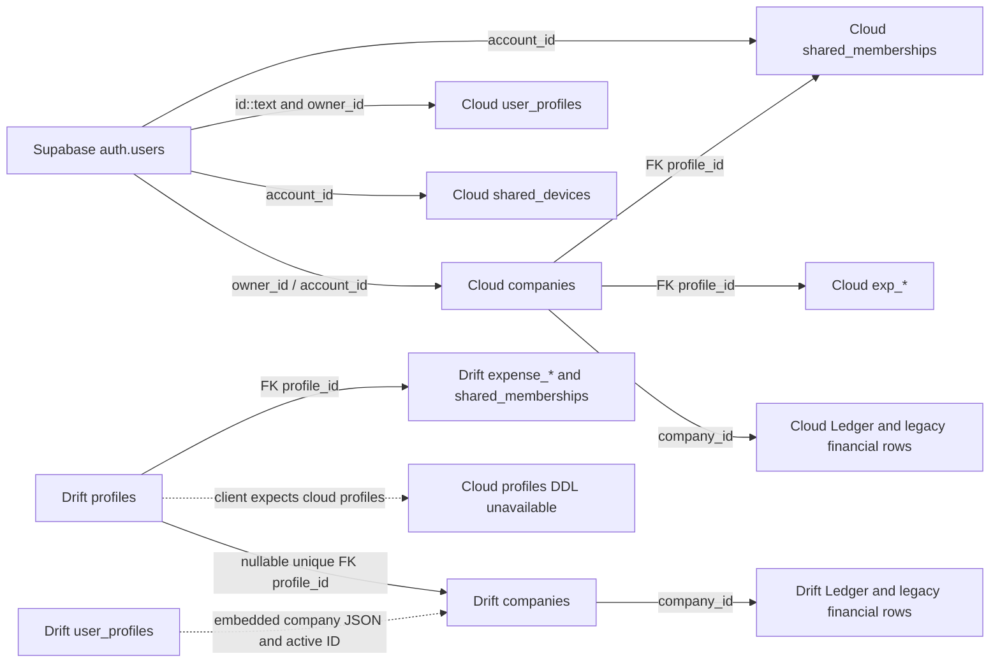

# LedgerPulse database architecture audit

**Review status** — Repository evidence as of 2026-11-22. Proposed dispositions require review. This audit used static inspection of tracked source, migrations, schema snapshots, generated code and tests. Deployed catalogs, policy grants, data distributions, storage configuration and migration history remain unverified. No database or application changes were made.

## Review priorities

- **Critical — A1.** The checked-in privileged sync RPC authorizes the request workspace independently of the existing row it mutates. Verify deployment and effective execution grants before relying on tenant isolation.
- **High — A2–A10.** Legacy policies, missing relationship constraints, independently synchronized workspace identities, non-atomic cloud postings and unguarded remote upserts can undermine authorization, recovery or financial integrity.
- **Medium — A11–A16.** Budget and recurring semantics, audit provenance, device lifecycle, report scoping, and schema/test parity need explicit contracts before cutover.
- **Low — A17.** Earlier architecture documents contain historical observations that diverge from current code.

Severity reflects potential impact under the checked-in code. A deployed incident or affected row count requires separate evidence. References below use line numbers from the audited checkout.

## 1. Current entity relationships

An arrow to a financial group indicates routing. The inventory below distinguishes database FKs from application conventions. Actual local creation and backfill normally use the same string for `profiles.id` and `companies.id`. Locally `companies.profile_id` is nullable and unique, so the FK permits profiles without companies and companies without profiles. Cloud member and Expense FKs in 0011 point to **companies.id**. The client also reads and queues **profiles** and sends **companies.profile_id**. Cloud migration 0018 updates **profiles**, although the forward migration chain contains no CREATE for it or ADD for **companies.profile_id**. A deployed catalog is necessary to verify those contracts. [Drift definitions](../../lib/data/local/database.dart#L19), [local backfill](../../lib/data/local/database.dart#L1031), [cloud FKs](../../supabase/migrations/0011_target_architecture_core.sql#L12), [client discovery](../../lib/presentation/providers/profile_session_controller.dart#L144), [cloud dependency](../../supabase/migrations/0018_disable_auto_workspace_provisioning.sql#L77)

Financial relationships in detail:

- Expense: each transaction has a source wallet, optional destination wallet and optional category. Categories have a parent category. Budgets optionally reference a category, recurring rules reference wallets and categories through a JSON template, and local attachment metadata references a transaction. A wallet opening amount is an input. Its current amount is derived.
- Ledger: a party has entries. A voucher is a business document and may post a journal, a party movement and stock movements. A journal has account lines. Accounts can have parents. Inventory items have stock movements. Reports and party screens consume different projections. IDs embedded in voucher line-item JSON and references such as voucher source IDs have their own semantics.
- Operations: the local outbox records intended mutations and the local state table records pull progress. Audit records describe user or system actions. Devices associate registrations with an account. None of those concepts is a workspace identity.

## 2. Table inventory and proposed disposition

Drift locations are in [database.dart](../../lib/data/local/database.dart#L19). Pull registrations and row conversion are in [sync_engine.dart](../../lib/core/network/sync_engine.dart#L2810). Cloud references derive from [0008](../../supabase/migrations/0008_modes_modules.sql#L13), [0009](../../supabase/migrations/0009_identity_sync_hardening.sql#L6), [0010](../../supabase/migrations/0010_emergency_security_hardening.sql#L93), and [0011](../../supabase/migrations/0011_target_architecture_core.sql#L12). A name in the cloud column with missing baseline DDL denotes a referenced contract.

| Supabase | Drift | Purpose, actual consumer, and proposed disposition |
| --- | --- | --- |
| `auth.users` | No table replica | Auth-managed identity and contacts used for sign-in. Keep. Local session selection uses UID. |
| `user_profiles` | `user_profiles` (77) | Personal data plus account role, business fields, serialized companies and active company. Auth bootstrap, onboarding, and account edits use it. Split personal fields into `public.users`, business fields into Ledger configuration where provenance supports it, and selection into a preference. Retire embedded company copies after compatibility ends. |
| `profiles` (client and 0018 reference) | `profiles` (19) | Workspace headers and selection source. Merge identity, owner, type, currency and lifecycle into `workspaces`. Map settings field by field. |
| `companies` | `companies` (40) | Workspace routing record carrying business details, mode, module flags and lifecycle. Merge common facts into `workspaces`, preserve typed configuration in `expense_profiles` or `ledger_profiles`. Keep ID compatibility during rollout. |
| `shared_memberships` | `shared_memberships` (429) | Workspace access by account and role. Bootstrap and sync consume it. Replace with `workspace_memberships` with explicit role, state and lifecycle semantics. |
| `shared_devices` | `shared_devices` (443) | Account/device registration contract. Cloud policy and schema exist. No normal Flutter table read/write or sync registration found outside schema code. Decide whether to adopt for device management or retire the unused persistence contract. |
| `parties` | `parties` (106) | Business counterparties, opening and cached net balances. Keep under Ledger, through party repository. |
| `ledger_entries` | `ledger_entries` (126) | Party movement history including gave/got, source linkage, void status and current payment metadata. Keep party-subledger facts, with an explicit relationship to the posting that generated them. Identify standalone historical entries before backfill. |
| `accounts` | `accounts` (278) | Ledger chart of accounts and cached balances, plus Expense category compatibility metadata. Keep Ledger accounts. Migrate reviewable Expense metadata to typed Expense categories or retire it when readers are gone. |
| `vouchers` | `vouchers` (304) | Ledger document header, lines/metadata and posting state. Keep Ledger documents, reconcile historical Expense vouchers to dedicated transactions, and preserve traceability. |
| `journals` | `journals` (342) | Accounting posting headers, source voucher link and status. Keep under Ledger, protect posting and reversal invariants. Reconcile historical Expense journals before archival. |
| `journal_lines` | `journal_lines` (365) | Account debit/credit legs used in Ledger financial statements. Keep under Ledger with scoped header/account integrity. |
| `inventory_items` | `inventory_items` (227) | Item master and stock projection. Keep under Ledger, separate initial stock and derived quantity. |
| `stock_ledger` | `stock_ledger` (253) | Item movements from inventory and posting workflows. Keep under Ledger and link source movements where evidence permits. |
| `audit_logs` | `audit_logs` (150) | Local audit events and hash chain; synced record family. Keep audit history, define authoritative append and actor rules. |
| `budgets` | `budgets` (386) | Legacy account/category limits. Retained in sync, old deletion and backfills. Current Expense budget repository uses dedicated rows. Archive after reconciliation or retain as a separate Ledger feature only upon product confirmation. |
| `recurring_rules` | `recurring_rules` (407) | Legacy recurring schedules. Retained in sync, deletion and backfills. Current recurring service uses dedicated Expense rules. Archive or retain as a Ledger feature after usage and data review. |
| `exp_wallets` | `expense_wallets` (472) | Wallet identity, type, currency, opening and cached current balance. Keep under Expense. |
| `exp_categories` | `expense_categories` (496) | Category hierarchy and presentation metadata. Keep under Expense, migrate legacy-only category configuration. |
| `exp_transactions` | `expense_transactions` (520) | Canonical current Expense income, expense and transfer movements, including receipt reference. Keep under Expense. |
| `exp_budgets` | `expense_budgets` (549) | Category-specific or overall limits, period, activation and rollover state. Keep under Expense. |
| `exp_recurring_rules` | `expense_recurring_rules` (573) | Expense schedule, JSON posting template and next run. Keep under Expense with scoped references and durable occurrence identity. |
| No row mapping found | `expense_attachments` (595) | Local attachment metadata schema with profile/transaction FKs. Active UI stores receipt references with transactions. Decide whether first-class attachments are required before adding any cloud mapping. |
| No row mapping found | `user_preferences` (460) | Declared local preference table. Active workspace uses SharedPreferences and legacy profile fields. Choose one preference contract and retire unused storage after checking upgrade dependencies. |
| No row mapping | `sync_outbox` (175) | Local coalesced pending mutation, retry and error state. Keep and migrate payloads and workspace routing with durable acknowledgment. |
| No row mapping | `sync_state` (196) | Local per-table scope cursor. Keep and version checkpoints across any scope or stream change. |
| `storage.buckets`, `storage.objects` | Receipt/logo references rather than replica tables | Managed storage schema. 0011 declares tenant path policies for the bucket. Inspect actual object ownership, path formats and app upload/download behavior before migrating URLs. |

The generated Drift schema introduces no additional application tables. It registers 25 table entities in [database.g.dart](../../lib/data/local/database.g.dart#L21843). Business subsystems such as payroll, manufacturing, invoices, payments, GST and licensing have Dart models and services. They are not separate application tables in the inspected schema. Voucher/account/stock postings and persisted document metadata must remain attributable to their actual source.

## 3. Authentication, workspace lifecycle and duplicated facts

1. Supabase Auth handles OTP and email/password. The repository restores SDK/session and preference-backed user state, and the reactive database provider selects a per-UID local file or guest file. Registration trigger 0016 originally provisioned a default workspace. 0018 replaces its body with personal-row provisioning only. Onboarding additionally creates/updates a local user profile and queues cloud synchronization. Auth identity and profile contact/display information have different lifecycles. Set an explicit source for verified contacts and establish whether separate contact details are editable. [Auth repository](../../lib/data/repositories/supabase_auth_repository.dart#L90), [DB selection](../../lib/presentation/providers/database_providers.dart#L9), [trigger](../../supabase/migrations/0018_disable_auto_workspace_provisioning.sql#L8), [onboarding](../../lib/presentation/auth/profile_onboarding_screen.dart#L124)
2. The active Flutter creation path is `DriftProfileRepository.createProfile`, which writes local profile/company rows and owner membership, seeds Expense defaults or Ledger accounts, and queues sync. Separate cloud RPC provisioning exists in 0012/0016. Legacy company create/update methods also write compatibility state. A dual-path cutover needs a single idempotency key and parity in seeded rows. The owner on a workspace and a membership role represent distinct facts only once their relationship is enforced. [Local creation](../../lib/presentation/providers/profile_session_controller.dart#L476), [seed and membership](../../lib/presentation/providers/profile_session_controller.dart#L657), [cloud provisioning](../../supabase/migrations/0016_auth_user_provisioning_trigger.sql#L38), [legacy workspace writes](../../lib/data/local/drift_companies_profile_mixin.dart#L374)
3. Discovery combines local headers, owned company rows, memberships and remote reads of four tables, with fallbacks and tombstone checks. Workspace selection reads scoped and legacy preferences plus profile state. Switching updates selection and company providers and triggers scoped sync. Login/session restoration is distinct from recovering a deleted workspace. The inspected profile repository interface exposes create, list and delete, and has no dedicated restore operation. [Discovery](../../lib/presentation/providers/profile_session_controller.dart#L37), [bootstrap](../../lib/presentation/providers/profile_session_controller.dart#L144), [selection](../../lib/presentation/providers/profile_session_controller.dart#L1096), [switch](../../lib/presentation/providers/profile_session_controller.dart#L1265), [interface](../../lib/domain/repositories/i_profile_repository.dart)
4. **A3 · High — Workspace identity and lifecycle can diverge.** Profile and company repeat name, type, owner, currency, active/deleted state and revision. These are competing copies where both are written independently. `companies_json` is a serialized compatibility representation, with company rows as a separate discovery source. Selection is a per-user/device preference, separate from a workspace being globally active. Deleting via `deleteProfile` issues separate writes and outbox entries. The older company deletion additionally tombstones selected Ledger/legacy children, creating different effect sets. Partial upload and old-client resurrection tests are required. [Local fields](../../lib/data/local/database.dart#L19), [profile deletion](../../lib/presentation/providers/profile_session_controller.dart#L803), [company deletion](../../lib/data/local/drift_companies_profile_mixin.dart#L429), [selection keys](../../lib/presentation/providers/company_providers.dart#L27)
5. **A4 · High — Local legacy-file adoption lacks UID proof.** The native fallback adopts an unscoped file on a count of at most one live profile and can copy a file after inspection failure. A count gives no ownership match. Also, sync fills absent or placeholder workspace owner values from the authenticated session, so recovery of legacy files and ownership attribution must be designed together. Verify actual legacy populations without assigning ambiguous records. [Native adoption](../../lib/data/local/connection/native.dart#L39), [owner normalization](../../lib/core/network/sync_engine.dart#L1837)

## 4. Foreign keys and tenant integrity

**A5 · High — Single-column relationships leave workspace equality implicit.** Local FK enforcement is enabled at open, but an ID-only FK verifies existence. The checked-in Cloud Expense FKs have the same limitation. Proposed review contract is a scope column on the child and composite references to scope plus identifier, or equivalent database-enforced invariants. Verify and repair mismatches before validation.

| Relationship | Source evidence and missing invariant |
| --- | --- |
| Expense transaction → source/destination wallet and category | Local and cloud FKs reference global IDs. Require matching workspace, a distinct transfer destination and an explicit category/type policy. Cloud transaction checks and FKs need testing together. [Drift](../../lib/data/local/database.dart#L520), [cloud](../../supabase/migrations/0011_target_architecture_core.sql#L143) |
| Expense category → parent, budget → category, attachment → transaction | Local category parent has no FK, cloud parent ID alone allows workspace mismatch. Budget category and local attachment transaction are ID-only. Require same scope and define cycle prevention and delete behavior. [Drift](../../lib/data/local/database.dart#L496), [budgets and attachments](../../lib/data/local/database.dart#L549), [cloud](../../supabase/migrations/0011_target_architecture_core.sql#L125) |
| Expense recurring rule → template references | JSON prevents declarative joins to wallet/category. Require references in the same workspace when a rule is written and generated, including archived/deleted handling. [Local schema](../../lib/data/local/database.dart#L573), [cloud](../../supabase/migrations/0011_target_architecture_core.sql#L195), [generation](../../lib/data/services/recurring_service.dart#L192) |
| Ledger entry → party and source voucher | Local party/company FKs validate separate parents. Source linkage is a compatibility identifier. Establish same workspace and discriminate standalone from voucher-generated movements. Pre-0008 Cloud party/entry baseline unavailable. [Drift](../../lib/data/local/database.dart#L106), [balance logic](../../lib/data/local/ledger_entry_balance.dart) |
| Account → parent, voucher → party/accounts, journal → voucher, journal line → journal/account | Drift lacks several header and parent references and uses ID-only references where present. Cloud 0008 has company FKs but leaves the internal links as text. Require matching workspace and decide posted document/source uniqueness before enforcing. [Drift](../../lib/data/local/database.dart#L278), [cloud](../../supabase/migrations/0008_modes_modules.sql#L13) |
| Stock movement → item and posting source | Local item FK is ID-only and company scope is independent. Cloud base constraints unavailable. Preserve source type and verify item, scope and source relationship. [Drift](../../lib/data/local/database.dart#L227), [posting engine](../../lib/data/accounting/voucher_posting_engine.dart#L386) |
| Legacy budget → account and recurring → template | 0008 company FK provides coarse scope. Local declarations and plain IDs/JSON leave underlying account/target integrity to code. Require same scope for retained Ledger data. [Drift](../../lib/data/local/database.dart#L386), [cloud](../../supabase/migrations/0008_modes_modules.sql#L97) |
| Workspace → owner, typed config and membership | Cloud 0009 adds nullable owner FKs to several legacy tables, and 0011 adds membership account/workspace FKs. Target needs immutable type, one matching subtype and a single authoritative owner with explicit transfer rules. Local account IDs are cache metadata with no local Auth table FK. [Cloud](../../supabase/migrations/0009_identity_sync_hardening.sql#L6), [membership](../../supabase/migrations/0011_target_architecture_core.sql#L12) |

**A6 · High — Domain constraints admit legacy Expense data in Ledger tables.** 0011 attaches validators to selected tables. 0017 redefines the Ledger validator to accept recognized Expense aliases as well as Ledger aliases and allows NULL through the trigger. Other Ledger tables rely on table constraints and policy predicates. Preserve legacy data during quarantine and require new financial rows to reference the correct typed workspace. Normalize aliases before enforcing immutability, and audit the target delete/cascade policy per relationship. [Trigger coverage](../../supabase/migrations/0011_target_architecture_core.sql#L249), [replacement](../../supabase/migrations/0017_fix_companies_and_memberships_rls.sql#L49)

## 5. Authorization and RLS

- **A1 · Critical — Privileged mutation boundary.** `sync_mutation_v3` is SECURITY DEFINER and granted to authenticated callers. Its authorization uses payload workspace and a broad mutation role set. Its delete statements select the existing target by record ID alone, and privileged upsert branches and legacy delegation need the same target-row and per-operation authorization review. Personal/device branches are exempt from the workspace check and need independent identity checks. Validate effective function owner, grants, signatures and deployed body. Require resolved target scope, table/action-specific permissions, and positive affected-row outcomes in the eventual contract. [RPC definition and checks](../../supabase/migrations/0012_target_rpcs_and_sync.sql#L227), [mutation branches](../../supabase/migrations/0012_target_rpcs_and_sync.sql#L315), [grant](../../supabase/migrations/0012_target_rpcs_and_sync.sql#L466)
- **A2 · High — Overlapping policies and inconsistent role enforcement.** 0008's public policies were explicitly dropped in 0010. 0014 drops several additional policies, but the tracked forward sequence leaves 0009's `owner_isolation_parties` and `owner_isolation_ledger_entries`, which accept row owner or company owner. Conditional 0010 policies for inventory, stock and audit also need effective catalog review. Permissive policies combine by OR. Confirm effective policy operation, role and grants, including command-specific restrictions, archived workspaces and direct REST writes. The 0011 policies offer `FOR ALL` on several financial families and thereby declare DELETE coverage. [Historical policies](../../supabase/migrations/0008_modes_modules.sql#L158), [legacy owner predicates](../../supabase/migrations/0009_identity_sync_hardening.sql#L58), [removal](../../supabase/migrations/0010_emergency_security_hardening.sql#L19), [overlap remediation](../../supabase/migrations/0014_remediate_permissive_rls_overlap.sql#L3), [typed-domain policy families](../../supabase/migrations/0011_target_architecture_core.sql#L389)
- **A7 · High — Owner and member administration semantics are wider than the target model.** 0017 authorizes company updates by owner or owner/admin membership. Membership policies and the invite RPC support role assignments including owner. `has_profile_role` falls back to direct owner as well as matching membership, and the checked helper needs lifecycle and permission review. The personal profile policies bind row ID to UID but cover whole rows, including legacy role and owner fields. Local user profile role is consumed by application providers and should never grant cloud access. Decide how owner transfer, admin delegation, revocation and offline entitlement expiry work. [Helper and membership policies](../../supabase/migrations/0011_target_architecture_core.sql#L292), [invite](../../supabase/migrations/0012_target_rpcs_and_sync.sql#L158), [user policies](../../supabase/migrations/0014_remediate_permissive_rls_overlap.sql#L48), [company update](../../supabase/migrations/0017_fix_companies_and_memberships_rls.sql#L11), [local role consumption](../../lib/presentation/providers/expense_providers.dart#L15)
- **A14 · Medium — Device and storage lifecycle lacks an end-to-end contract.** Device table RLS is account-based. It is separate from SDK session identity and currently has no active sync registration. Membership revocation, logout and workspace deletion must specify effects on cached data and stored objects. 0011 defines storage policies based on path and role. The actual bucket settings and legacy access policies are unknown. Review function execution privileges and pinned search paths for all SECURITY DEFINER functions, including legacy mutation helpers and the 0017 trigger replacements. [Device and storage policies](../../supabase/migrations/0011_target_architecture_core.sql#L358), [bucket policies](../../supabase/migrations/0011_target_architecture_core.sql#L551), [SQL helpers](../../supabase/migrations/0017_fix_companies_and_memberships_rls.sql#L25), [local session disposal](../../lib/presentation/providers/database_providers.dart#L23)

## 6. Sync and financial consistency

| Finding | Evidence, consequences, and target disposition |
| --- | --- |
| **A8 · High — Remote upserts have no expected-version condition** | The gateway uses direct PostgREST upsert. Outbox acknowledgment checks local revision and guards session invalidation. Pull handling protects pending rows and compares some revisions/tombstones. These controls do not establish cross-device optimistic concurrency. Two offline edits can overwrite each other or resurrect a deleted row remotely. Preserve mutation identity, server revision and explicit conflict outcomes. [Gateway](../../lib/core/network/sync_engine.dart#L94), [push](../../lib/core/network/sync_engine.dart#L1989), [ack](../../lib/core/network/sync_engine.dart#L2107), [pull apply](../../lib/core/network/sync_engine.dart#L4136) |
| **A9 · High — Accounting transaction boundaries stop at Drift** | Voucher posting creates journal/lines and other effects in a local transaction. The cloud queue sends individual rows. An accepted header with failed lines, or a partial void, can yield a materially wrong report. Require atomic posting/reversal of authoritative movements, idempotent retries and server-side debit/credit balance validation. Current RPC OCC only checks older revisions on posted vouchers/journals and does not make a posting atomic. [Posting](../../lib/data/accounting/voucher_posting_engine.dart#L386), [row push](../../lib/core/network/sync_engine.dart#L1713), [RPC revision](../../supabase/migrations/0012_target_rpcs_and_sync.sql#L301) |
| **A10 · High — Financial projections can diverge from source movements** | Party cached balances depend on opening and qualifying entry effects. Ledger account balances depend on journal status and debit/credit lines. Wallet balances depend on opening and signed Expense transactions. Stock quantities and movements also need reconciliation. Pull recalculates wallet/account projections but row-based transfer and incomplete pulls can expose intermediate states. Keep source movements, use derived projections for reads, and reconcile per workspace, currency, account, party, wallet and item. Preserve explicit input amounts separately. [Entry changes](../../lib/data/local/drift_entries_mixin.dart), [Expense reversal and wallet recompute](../../lib/data/local/drift_expense_repository.dart#L599), [wallet recompute](../../lib/data/local/drift_expense_repository.dart#L1251), [sync recomputes](../../lib/core/network/sync_engine.dart#L4352), [stock repository](../../lib/data/local/drift_inventory_repository.dart) |
| **A11 · Medium — Expense metadata and budget compatibility are still used** | The primary Expense provider instantiates `drift_expense_repository.dart`, whose transaction writes target dedicated tables but category metadata reads/writes still involve legacy `accounts`. Category archive behavior depends on that overlay. Budget CRUD/restoration and progress use Expense budgets and transactions, with category descendants, periods and rollover. NULL category means an overall budget and should have explicit uniqueness and aggregation semantics. The separately named v2 repository exposes typed models and no active production import was found. Consolidate the interface after migrating category metadata. [Provider](../../lib/presentation/providers/expense_providers.dart#L15), [category overlay](../../lib/data/local/drift_expense_repository.dart#L1313), [archive](../../lib/data/local/drift_expense_repository.dart#L1525), [budget progress](../../lib/data/local/drift_budget_repository.dart#L641), [overall budgets](../../supabase/migrations/20261117202902_allow_overall_expense_budgets.sql#L1), [typed implementation](../../lib/data/local/drift_expense_repository_v2.dart#L12) |
| **A12 · Medium — Recurring schedule advancement is separately persisted** | `generateDue` serializes within the service instance and uses deterministic occurrence transaction IDs. Failed posting leaves the occurrence due, and rule advancement is separately written. This handles many local retries, but multiple offline devices can reconcile conflicting schedule edits or generated content independently. Specify occurrence identity, calendar/time zone, advancement and replay semantics. [Recurring generation](../../lib/data/services/recurring_service.dart#L173), [advancement](../../lib/data/services/recurring_service.dart#L300) |
| **A13 · Medium — Audit chain is client-generated** | `AuditService` records and verifies a company chain locally. Concurrent offline devices can append from the same predecessor. Client-supplied actor/payload plus accepted row replacement should not be treated as authoritative change history. Remediate with server-attributed append events and preserve local provenance, historical hashes and reconciliation evidence. [Audit append](../../lib/data/local/audit_service.dart#L41), [verification](../../lib/data/local/audit_service.dart#L117), [cloud audit policy](../../supabase/migrations/0011_target_architecture_core.sql#L516) |
| **A15 · Medium — Report scope depends on the data access path** | Reports consume party entries, Expense transactions, or journals/accounts according to report type. The custom SQL engine executes sanitized local SQL. Verify that templates enforce workspace boundaries on joins and subqueries within the per-UID database, especially once shared access and revocation are supported. [Custom reporting](../../lib/data/reporting/custom_sql_report_engine.dart#L148), [financial reporting](../../lib/data/reporting/financial_statement_engine.dart), [Expense reporting](../../lib/data/reporting/expense_report_engine.dart) |
| **A16 · Medium — Sync readiness and bootstrap can silently differ from expected schema** | Pull treats missing relations and schema-cache errors as empty results. Cursor pages use ordered timestamp/ID and inclusive timestamp restart, with skipped-row tracking and recalculation before advancement. A missing table and a truly empty workspace can appear alike. Timestamp-based discovery cannot convey physical deletes or rows hidden by revoked RLS. Expose contract mismatch, represent deletions durably and test checkpoint rewinds and membership removal. [Pull gateway](../../lib/core/network/sync_engine.dart#L114), [cursor flow](../../lib/core/network/sync_engine.dart#L3558), [recalculation and advancement](../../lib/core/network/sync_engine.dart#L3723) |

The outbox is a local row-change stream with a target table, row identifier, payload, status and retry metadata. The engine scans pending rows, repairs qualifying failures, sorts/processes dependencies and requeues dirty rows. It serializes work within one engine and has session-generation guards. Review permanent failure recovery and routing changes for the same operation across switches. The payload converts legacy camelCase keys, JSON and domain-specific columns. Sync registration covers the 20 remote-mapped application row families in the inventory, excluding Auth, Storage, devices and local-only tables. [Outbox](../../lib/data/local/outbox_helper.dart), [queue recovery](../../lib/core/network/sync_engine.dart#L629), [dependency repair](../../lib/core/network/sync_engine.dart#L1319), [sync tables](../../lib/core/network/sync_engine.dart#L2810), [provider orchestration](../../lib/presentation/providers/sync_providers.dart)

## 7. Migration history and legacy dependencies

### PostgreSQL

- **0001–0007** — Absent from tracked migration files. Definitions for referenced base tables, deployed policy history, grants and any out-of-band `profiles` DDL require a read-only catalog export to close the evidence gap. Test fixture DDL is a test contract.
- **0008** — Adds mode/module fields and six finance tables, permissive initial policies and `sync_mutation`. **0009** — Adds owner/revision infrastructure, policies and v2 mutation function. **0010** — Hardens historical public policies and adds owner gates. Review their companion verification/rollback scripts with the effective deployment state.
- **0011** — Adds memberships/devices, dedicated Expense tables, role helpers, type validation, revision triggers and storage policies. Its rollback drops those structures and its verification checks shape and policy evidence. **0012** — Adds provisioning/invite/v3 RPCs, with rollback and verification companions.
- **0013** — Stages owner correction, membership backfill and copying legacy Expense data without retiring the sources. Its verification and rollback scripts are operational evidence. Reconcile wallet-opening assumptions, amount/status transforms and skipped foreign-key targets before trusting backfilled balances. **0014** — Removes named overlapping policies and adds legacy budget/recurring policies, with rollback and verification companions.
- **0015** — Pending approval file. Candidate cleanup of profile fields, legacy RPC and finance tables is dependency-sensitive. Keep it out of an execution manifest. **0016** — Adds Auth registration hook and privileged provisioning, with rollback/verification companions. **0017** — Alters company and membership policies and broadens compatibility in validators. **0018** — Changes registration to personal provisioning and tombstones placeholder `cmp_default` in cloud profiles.
- **20261117201515** — Adds missing membership revision used by a preexisting update trigger. **20261117202902** — Allows NULL category for overall Expense budgets. **20261121172152** — Adds checked Ledger `payment_method` and `entry_kind`.
- Keep [orphan-account recovery scripts](../../supabase/scripts), [misplaced Ledger repair](../../scripts/repair_misplaced_ledger_records.sql), [posting reconciliation](../../scripts/reconcile_ledger_postings.sql), and [live migration runner](../../supabase/apply_live_migrations.py) as historical dependencies to review. Check numeric prefix collisions across forward, verify and rollback files before defining any future execution manifest. Existing rehearsal documents describe a prior run and cannot establish the current catalog. [Migration directory](../../supabase/migrations), [pending cleanup](../../supabase/migrations/0015_post_observation_legacy_cleanup.sql.pending_approval), [rehearsal](staging_migration_rehearsal_report.md)

### Drift

The source schema is v14, with generated entities in `database.g.dart`. The generated step runner reaches v12 via callbacks v1→2 through v11→12. V13 adds Ledger entry payment/kind fields. V14 adds Expense-budget rollover/active fields and conditionally restores values from same-ID, same-scope legacy budgets. New installs use the current entity definitions. Historical copies and default identifiers can already exist on devices. [Migration entry point](../../lib/data/local/database.dart#L646), [step dispatcher](../../lib/data/local/schema_steps.dart#L8098)

- v1→2 adds party deletion and entry void status. v2→3 creates companies and audit logs and gives parties and entries company IDs. v3→4 adds inventory, stock movements and vouchers. v4→5 introduces the outbox and soft-delete/sync fields across persisted domains. [Early steps](../../lib/data/local/database.dart#L686)
- v5→6 adds user profiles and business, tax, branding and banking fields on companies. v6→7 adds accounts, journals and journal lines. v7→8 adds mode/modules, voucher account references, budgets and recurring rules. v8→9 adds sync checkpoints and revision/remote timestamp metadata. v9→10 adds account kinds and performs compatibility updates. [Middle steps](../../lib/data/local/database.dart#L776), [v8–v10](../../lib/data/local/database.dart#L823)
- v10→11 adds memberships, devices, preferences, dedicated Expense rows and attachments, then copies qualifying legacy Expense data. v11→12 adds profiles and company linkage and repeats compatibility backfills with `INSERT OR IGNORE`. Copies can preserve `sync_status` from legacy sources and can synthesize a wallet fallback. Provenance and source revision therefore matter independently of matching IDs. Preserve pending operations, tombstones, aliases, audit hashes and legacy balances until checked. [Expense backfill](../../lib/data/local/database.dart#L918), [profile backfill](../../lib/data/local/database.dart#L1031)
- `drift_schemas` tracks versions 1–12. The test schema dispatcher covers 1–11. V13 and v14 are hand-written upgrade steps. The current generated code and snapshot parity should be verified for fresh creation, staged upgrades and old clients. [Snapshots](../../drift_schemas), [test schema dispatcher](../../test/generated_migrations/schema.dart#L19), [migration tests](../../test/database_migration_test.dart#L19)
- **A17 · Low — Historical documentation drift.** Earlier reports describe an earlier schema version and Expense posting entirely through Ledger, and pre-hardening public policies. Reuse the history and traceability documents with their dates and revalidate claims against this migration chain and current providers. [Earlier audit](current-state-audit.md), [active Expense writes](../../lib/data/local/drift_expense_repository.dart#L303), [policy removals](../../supabase/migrations/0010_emergency_security_hardening.sql#L19)

## 8. Target disposition and exact source impact

Keep Supabase Auth as identity. Use `public.users` keyed by Auth UID for personal data. Merge common fields from profile and company rows into `public.workspaces` with one owner, normalized type, currency and lifecycle. Preserve one-to-one typed settings in `public.expense_profiles` and `public.ledger_profiles`, with one Ledger workspace per business. Scope financial roots to the matching subtype and child FKs to the same workspace. Replace shared memberships with `public.workspace_memberships`. Preserve current IDs or explicit immutable aliases for all financial joins and queued mutations. These are proposed dispositions.

The following paths identify the implementation surface. Existing applied SQL is historical input. Future migration filenames and generated output versions depend on the approved design.

| Area | Exact files and disposition |
| --- | --- |
| Local schema and build artifacts | `lib/data/local/database.dart`, `lib/data/local/database.g.dart`, `lib/data/local/schema_steps.dart`, `test/generated_migrations/schema.dart`, and snapshots in `drift_schemas/`. Author the source schema and migrations after approval and regenerate the dependent artifacts. Review `lib/data/local/connection/connection.dart`, `native.dart` and `web.dart` for file/identity adoption where supported. |
| Identity and workspaces | `lib/data/repositories/supabase_auth_repository.dart`, `lib/domain/repositories/i_auth_repository.dart`, `lib/domain/repositories/i_profile_repository.dart`, `lib/domain/models/workspace_profile_header.dart`, `lib/data/models/user_profile_model.dart`, `lib/data/models/company_model.dart`, `lib/data/models/company_mode.dart`, `lib/data/local/drift_companies_profile_mixin.dart`. Separate Auth/session, personal profile, workspace discovery, typed settings and legacy mapping. |
| Session and selection | `lib/presentation/providers/auth_providers.dart`, `database_providers.dart`, `profile_provider.dart`, `profile_session_controller.dart`, `profile_session_state.dart`, `company_providers.dart`, `rbac_providers.dart`, `module_providers.dart`; `lib/presentation/auth/app_root_gate.dart`, `profile_onboarding_screen.dart`, `profile_selector_screen.dart`, `phone_input_screen.dart`, `otp_screen.dart`; `lib/presentation/home/create_company_flow.dart`, `company_switcher_sheet.dart`, `edit_profile_sheet.dart`, `home_shell.dart`; `lib/presentation/profile/profile_screen.dart`. Bind these to one workspace/session selection contract, reusing current screen behavior where valid. |
| Active Ledger repositories | `lib/domain/repositories/i_ledger_repository.dart`, `lib/data/local/drift_ledger_repository.dart`, `drift_ledger_base.dart`, `drift_entries_mixin.dart`, `drift_parties_mixin.dart`, `drift_accounts_journals_mixin.dart`, `drift_voucher_repository.dart`, `drift_inventory_repository.dart`, `ledger_entry_balance.dart`; `lib/presentation/providers/ledger_providers.dart`, `voucher_providers.dart`, `inventory_providers.dart`. Keep features and replace the tenancy and posting interfaces. |
| Alternative repository implementations | `lib/data/api/api_ledger_repository.dart`, `lib/data/local/local_asset_ledger_repository.dart`, `lib/data/mock/mock_ledger_repository.dart`, `lib/data/mock/mock_auth_repository.dart`, `lib/data/mock/mock_seed_data.dart`. These are parallel adapters/fixtures. The active Ledger provider binds Drift. Update contracts where supported and retire compatibility adapters only once call sites and tests confirm retirement. |
| Expense, budgets and recurring | `lib/domain/repositories/i_expense_repository.dart`, `lib/data/local/drift_expense_repository.dart`, `drift_expense_repository_v2.dart`, `drift_budget_repository.dart`, `lib/data/services/recurring_service.dart`, `expense_csv_import_service.dart`; `lib/presentation/providers/expense_providers.dart`, `budget_providers.dart`, `recurring_providers.dart`; `lib/presentation/expense/quick_add_transaction_sheet.dart`, `accounts_screen.dart`, `budgets_screen.dart`, `recurring_screen.dart`. Close the legacy category overlay and move callers to a typed Expense interface. |
| Sync, access and audit | `lib/core/network/sync_engine.dart`, `sync_contract.dart`, `sync_codec.dart`, `ledger_sync_serializer.dart`, `expense_sync_serializer.dart`, `lib/data/local/outbox_helper.dart`, `audit_service.dart`, `lib/data/security/access_control_service.dart`, `lib/presentation/providers/sync_providers.dart`; `supabase/tests/database_contract_test.py`, `supabase/apply_live_migrations.py`. Update scope routing, typed serialization and conflict outcomes together. Audit grants and cloud RPC contracts during cutover. |
| Accounting and reporting | `lib/data/accounting/voucher_posting_engine.dart`, `manufacturing_journal_engine.dart`, `gst_tax_engine.dart`; `lib/data/reporting/financial_statement_engine.dart`, `expense_report_engine.dart`, `inventory_report_engine.dart`, `gstr_json_engine.dart`, `custom_sql_report_engine.dart`, `report_catalog.dart`, `report_export_service.dart`, `report_models.dart`; `lib/presentation/providers/reporting_providers.dart`, `lib/presentation/reports/audit_log_screen.dart`. Scope persistence/query callers and validate derived amounts. Pure calculation and serialization services need compatibility validation where their contracts are preserved. |
| Integrations and device consumers | `lib/data/services/data_import_service.dart`, `ecommerce_sync_service.dart`, `payment_gateway_service.dart`, `payroll_service.dart`, `einvoice_ewaybill_service.dart`, `gst_validation_service.dart`, `cts2010_cheque_printer_service.dart`, `licensing_service.dart`; `lib/core/services/widget_entry_service.dart`, `widget_sync_service.dart`, `lib/presentation/providers/widget_sync_provider.dart`, `subscription_providers.dart`. Keep integrations, pass typed workspace context at transaction entry points, and verify that external identifiers, exports, templates and licensing retain their meanings. No separate persistence move is indicated for pure calculators or exports. |
| Model and companion contract | `lib/data/models/account_model.dart`, `audit_log_model.dart`, `budget_model.dart`, `inventory_item_model.dart`, `journal_model.dart`, `party_model.dart`, `rbac_model.dart`, `recurring_rule_model.dart`, `stock_ledger_model.dart`, `sync_model.dart`, `transaction_model.dart`, `voucher_model.dart`, `expense/expense_category_model.dart`, `expense/expense_transaction_model.dart`, `expense/expense_wallet_model.dart`. Map scope and reference fields without conflating document, party subledger and posting identities. `gst_models.dart`, `manufacturing_bom_model.dart`, `payroll_model.dart`, and `subscription_tier_model.dart` are indirect consumers to validate where their business/settings types change. |

Drift access is implemented through generated tables/companions and repository, service or provider queries. There is no separate annotated DAO family in the inspected local source. UI call sites that only read provider results depend on contract preservation, whereas screens that construct scope identifiers or query Drift directly need explicit review.

## 9. Migration and test gates for review

1. **Freeze the evidence baseline.** Obtain read-only metadata for effective table/FK/index definitions, functions and owners, grants, active RLS/storage policies, trigger definitions and migration state. Compare against this audit. Decide if a canonical cumulative baseline is required before clean PostgreSQL integration tests. Preserve source files and operational artifacts.
2. **Reconcile before adding constraints or switching visibility.** Count identity mappings, orphan owners, missing subtype rows, unequal company/profile IDs, duplicate memberships, missing or cross-scope references and ambiguous legacy Expense conversions. Compare monetary totals by source/status/currency and movement counts by domain. Include opening balances, voids, net-zero journals, stock movements, rollover metadata, recurring templates and attachment references.
3. **Rehearse sync with mixed client versions.** Verify local schema v1–v14 populations, fresh versus migrated parity, pending and failed outbox rows, placeholders, identity-based file recovery, interrupted posting, restart after acknowledgment, stale writes and owner/member changes. Decide how old API clients and offline devices spanning the rollout are supported.
4. **Test deployed-equivalent authorization.** Use real PostgreSQL roles and the final forward migration set in an authorized later rehearsal. Assert two separate accounts, multiple workspaces owned by one account, removed/invited members, read-only roles, cross-workspace references, typed-domain restrictions, mutation actor and scope binding, storage path ACLs and physical delete restrictions. Verify posted documents under concurrent writes and check that errors and zero affected rows surface accurately.
5. **Verify current coverage gaps.** `test/architecture/database_architecture_test.dart` covers local profile/company linkage, dedicated Expense writes, budgets, posting balance and failure persistence. `test/database_migration_test.dart` and generated fixtures cover historical versions, with older labels in test names. `test/auth/`, `test/profile/`, `test/company_switcher_edit_delete_test.dart`, and `test/database/reactive_database_selection_test.dart` cover lifecycle and account switching. `test/sync/` exercises strict fake contracts, recovery, revisions, timestamps and deletion. Use `test/audit_trail_test.dart`, `test/budgets_and_recurring_test.dart`, `test/voucher_posting_engine_test.dart`, `test/expense_posting_test.dart`, `test/double_entry_accounting_test.dart`, `test/inventory_stock_ledger_test.dart`, and reporting/import suites for financial regressions. The Python Cloud contract builds a fixture and targets 0010–0012, which does not establish end-to-end behavior for later forwards or catalog drift. Tests were inspected without executing migration fixtures. [Architecture tests](../../test/architecture/database_architecture_test.dart#L79), [cloud fixture](../../supabase/tests/database_contract_test.py#L23), [sync tests](../../test/sync)

## 10. Decisions required before implementation

- Durable identifier choice and mapping for differing profile/company IDs, ambiguous owner provenance, local guest files and already queued mutations.
- Authoritative personal contact fields, verified Auth claims and treatment of legacy role, business name, logo and contact data stored on user profiles.
- Canonical ownership versus membership role, transfer rules, invite acceptance, revocation and offline cache retention.
- Selection as device preference, synchronized account preference or both, with explicit precedence. Workspace lifecycle states, restoration rules, retention and archival policies, including effects on financial and audit history.
- Enforce subtype creation atomically and choose currency mutation rules after the first financial record. Decide whether historical currency changes need per-record currency metadata.
- Financial source of truth and mutation unit for standalone and voucher-derived Ledger entries, posted journal corrections, inventory and Expense balances. Decide which projections are rebuilt locally and which are persisted server-side.
- Legacy Expense opening balances, category hierarchy/archival metadata, historical journals, legacy Ledger budgets/recurring rows and voucher copies. Decide case-by-case reconciliation and retention policy.
- Recurring execution ownership, time zone and occurrence/retry semantics. Overall and category budget overlap, uniqueness, period boundary and rollover rules.
- First-class attachments, storage object lifecycle, server audit provenance, and whether device registrations are needed in addition to Supabase sessions.
- Cloud compatibility horizon, checkpoint reseeding, financial comparison thresholds, rollback conditions, and catalog/reconciliation evidence required for destructive legacy cleanup.
