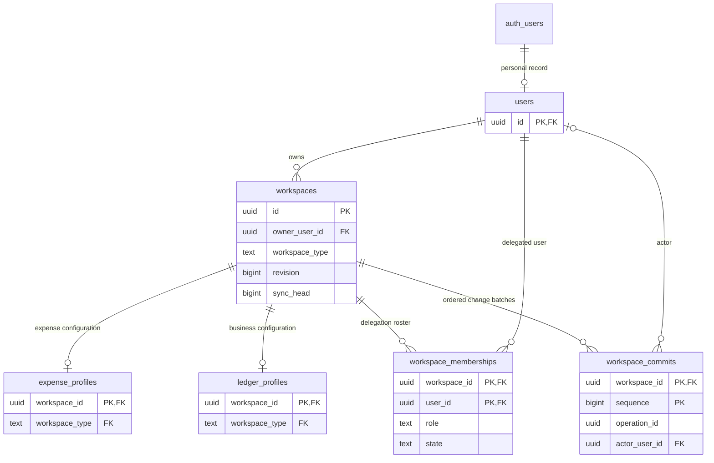
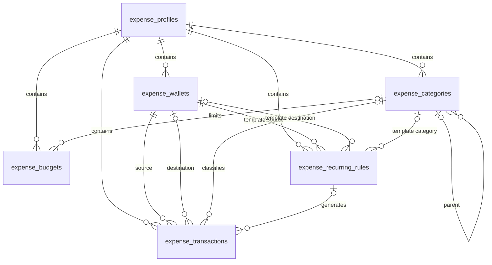
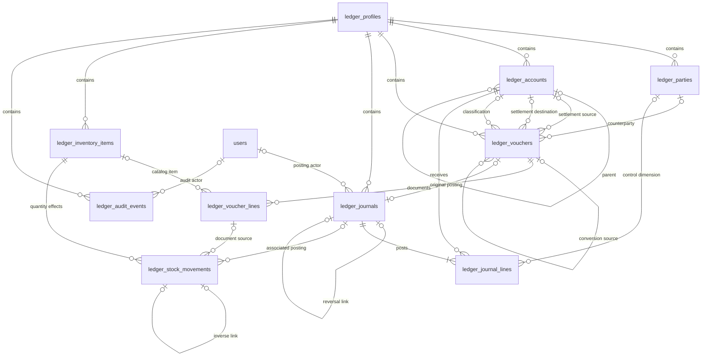

# LedgerPulse target ERD

**Status** — Proposed. The [target specification](database_target.md) defines the columns, constraints and authorization rules. The [migration plan](database_migration_plan.md) defines conversion and verification gates. The diagrams use physical table names with schema prefixes where useful.

## Identity, ownership and sharing

Auth provisioning establishes a personal row for each onboarded account. The workspace subtype edges form an exclusive pair. At commit, every workspace has exactly one matching subtype. The owner is always one user. A user can own zero or many workspaces and a workspace can have zero or many distinct delegated users. At launch, only ownership grants access. `workspace_commits` is private infrastructure and has an alternate key on workspace plus operation ID.

## Expense

All Expense relationships use the workspace from the related subtype. A destination wallet is required only for transfers. One rule can generate many transactions over time, with at most one transaction per scheduled date. The NULL-category budget edge represents an overall budget.

## Ledger

A draft or a non-accounting document can have no original posting. Every posted accounting voucher has exactly one original, with any reversal linked to that journal. A journal can originate outside a voucher. Each committed journal contains two or more balanced lines. A party balance only uses its applicable control-account legs. Voucher lines, journal lines and stock movements also have Ledger subtype FKs. The diagram shows their principal parent edges. Audit subjects are historical references verified at append time.

## Persistence boundary

- PostgreSQL stores authoritative accepted entities, immutable accounting history, audit events and private commit receipts. Supabase Storage holds private binary objects referenced by typed object keys. Object existence, scope and attachment eligibility are validated at assignment time.
- Drift mirrors authorized account and workspace data and the business subset required offline. Device selection, pending work, conflict state and pull checkpoints are local. SQLite projections for balances, party statements or search may be rebuilt from confirmed facts and pending overlays.
