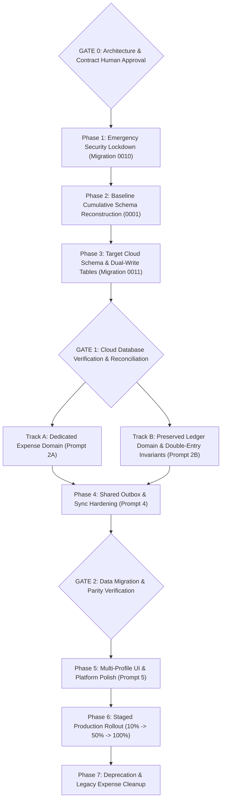

# Staged Implementation Sequence & Rollout Plan

**Contract Version:** `v1.0.0-PROD-CONTRACT-20261106`  
**Status:** Approved Architectural Target (Read-Only Specification)  
**Execution Rule:** Phase 0 (Approval Gate) must be signed off prior to executing Phase 1. Zero code implementation occurs during design phase.  

---

## 1. Implementation Phasing Roadmap



---

## 2. Phase-by-Phase Execution Plan

### Phase 0: Architecture Approval Gate (Current Phase)
- **Objective:** Complete read-only audit and produce final frozen architecture contracts.
- **Deliverables:**
  - `docs/architecture/current-state-audit.md`
  - `docs/architecture/target-architecture.md`
  - `docs/architecture/cloud-erd.md`
  - `docs/architecture/local-erd.md`
  - `docs/architecture/data-dictionary.md`
  - `docs/architecture/rls-matrix.md`
  - `docs/architecture/legacy-migration-map.md`
  - `docs/architecture/implementation-sequence.md`
- **Gate Criteria:** Explicit sign-off by human principal on all contracts before any code or migration is touched.

---

### Phase 1: Emergency Cloud Security Lockdown (Migration 0010)
- **Objective:** Immediately seal the 6 unrestricted public RLS policies from migration 0008 and close the `owner_id IS NULL` bypass.
- **Actions:**
  - Execute `0010_emergency_security_hardening.sql`.
  - Verify with security verification test suite.
- **Rollback:** In the unlikely event of an outage, execute `0010_emergency_security_hardening_rollback.sql` restoring owner-scoped policies.

---

### Phase 2: Baseline Cumulative Schema Reconstruction
- **Objective:** Create a canonical `0001_initial_cumulative_schema.sql` consolidating tables created prior to migration 0008.
- **Actions:**
  - Introspect live database metadata or use Drift v10 DDL.
  - Test fresh database spin-up in local CI environment (`supabase start`).

---

### Phase 3: Cloud Schema Target Expansion (Migration 0011)
- **Objective:** Create dedicated Expense tables and membership governance on Supabase without modifying existing tables.
- **Actions:**
  - Create `shared_memberships`, `shared_devices`.
  - Create `exp_wallets`, `exp_categories`, `exp_transactions`, `exp_budgets`, `exp_recurring_rules`.
  - Attach RLS policies from [`rls-matrix.md`](file:///c:/Programming/app/Ledger%20Pulse/docs/architecture/rls-matrix.md).
  - Attach immutability trigger preventing `companies.mode` mutation.
  - Run non-destructive backfill query copying historical expense vouchers to `exp_transactions`.

---

### Phase 4: Parallel Development Tracks (Prompts 2A, 2B, 4)

#### Track A: Dedicated Expense Domain (Prompt 2A)
- Define Drift Schema v11 with `ExpenseTransactions`, `ExpenseWallets`, `ExpenseCategories`.
- Implement `DriftExpenseRepository` operating strictly on single-entry tables.
- Decouple Expense UI (`QuickAddTransactionSheet`, `TransactionsScreen`, `AccountsScreen`) from `VoucherPostingEngine`.
- Delete `upgradeToLedger` from settings and profile controllers.

#### Track B: Ledger Invariant Preservation (Prompt 2B)
- Retain `VoucherPostingEngine`, `Journals`, `JournalLines`, `Accounts`, `Parties`, `Inventory`.
- Assert strict double-entry balance ($\sum \text{Dr} = \sum \text{Cr}$) on all posted transactions.
- Preserve GST Tax calculation, GSTR report generation, inventory stock ledger, and cryptographic audit hash chain.

#### Track C: Sync & Outbox Hardening (Prompt 4)
- Update `outbox_helper.dart` whitelist to include `exp_transactions`, `exp_wallets`, `exp_categories`, `inventory_items`, `stock_ledger`, `audit_logs`.
- Implement Optimistic Concurrency Control (OCC) using `revision` checks on remote upsert.
- Implement exponential backoff retry and payload validation.

---

### Phase 5: Multi-Profile UI & Platform Adaptive Polish (Prompt 5)
- **Multi-Profile Experience:**
  - Update `HomeShell` and profile switcher to list all owned and shared profiles for the authenticated account.
  - Display clear badges: `[Expense Tracker]` vs `[Business Ledger]`.
  - Guard mode-specific features cleanly (no ledger screens accessible in expense profile).
- **Platform Design System Polish:**
  - Android: Audit all screens for Material 3 Expressive styling (color schemes, rounded pill surfaces, dynamic color tokens).
  - iOS: Audit all screens for iOS 27 Cupertino styling (translucent navigation bars, grouped table views, Cupertino action sheets).

---

### Phase 6: Staged Production Rollout
1. **Internal Alpha (10%):** Dogfooding with internal test accounts. Run daily reconciliation queries.
2. **Beta Flight (25%):** Roll out to opt-in beta users. Validate multi-device sync and offline queue durability.
3. **General Availability (100%):** Switch production traffic entirely to single-entry expense engine and multi-profile switcher.

---

### Phase 7: Deprecation & Archival
- After 90 days of zero discrepancies:
  - Archive historical expense rows in `vouchers`/`journals` as read-only.
  - Deprecate unused legacy sync endpoints.

---

## 3. Comprehensive Rollback & Disaster Recovery Plan

| Failure Point | Detection Signal | Rollback Action | Data Impact |
| :--- | :--- | :--- | :--- |
| **Phase 1 (Security Lockdown)** | Client receives 403 Forbidden on sync | Revert to interim owner-scoped policies (`0010_rollback.sql`) | Zero data loss. |
| **Phase 3 (Migration 0011)** | Postgres DDL syntax error or timeout | Execute `0011_rollback.sql` dropping `exp_*` tables | Zero impact on legacy tables. |
| **Phase 4 (Drift Migration v11)**| SQLite migration assertion failure on client startup | Drift automatic database file restore from backup `ledger_pulse_<uid>.sqlite.bak` | Zero data loss. |
| **Phase 4 (Expense Sync Anomaly)**| Reconciliation query detects amount mismatch between vouchers and exp_transactions | Pause sync engine. Re-run idempotent backfill script | Read-only historical vouchers remain intact. |
| **Phase 5 (UI Crash in Switcher)**| Flutter fatal assertion on profile swap | Local fallback to first profile; force active profile reset | Memory state only. |

---

## 4. Verification & Testing Gates

Every phase must pass its explicit test gate before advancing:

```
[Phase 1 Security Gate]
├── RLS isolation unit test: User B cannot read User A's vouchers (Assert: 0 rows returned)
└── Anonymous client attempt to read public.accounts fails with 401/403

[Phase 3 Cloud Migration Gate]
├── Reconciliation Check 1: Count(vouchers WHERE type IN (exp,inc,trf)) == Count(exp_transactions)
├── Reconciliation Check 2: Sum(vouchers.total_amount) == Sum(exp_transactions.amount)
└── Immutability trigger test: Attempt to update companies.mode throws exception

[Phase 4 Drift & Engine Gate]
├── Drift migration test: v10 -> v11 migration succeeds on populated database
├── Zero-journal test: Creating an expense transaction creates exactly 0 rows in journals & journal_lines
└── Ledger regression test: Creating a sales invoice creates balanced journal lines (Sum Dr == Sum Cr)

[Phase 5 UI & Navigation Gate]
├── Multi-profile test: Switching profiles updates activeProfileId without restarting app
└── Design token test: Android renders Material 3 widgets; iOS renders Cupertino widgets
```

---

## 5. Human Approval Sign-Off Blockers

Before parallel execution of Prompts 2A, 2B, 4, or 5 can commence, the human principal must explicitly confirm:

1. **Sign-Off on Emergency Migration 0010:** Authorize running `0010_emergency_security_hardening.sql` to close the open public RLS policies.
2. **Sign-Off on Non-Destructive Expense Copy:** Confirm approval of copying Expense data into `exp_*` tables while leaving legacy vouchers/journals intact.
3. **Sign-Off on Profile Immutability:** Confirm that profile type cannot be mutated, and approve the removal of `upgradeToLedger`.
4. **Sign-Off on Contract Version:** Freeze all downstream work against `v1.0.0-PROD-CONTRACT-20261106`.

---
*End of Staged Implementation Sequence Specification (`docs/architecture/implementation-sequence.md`)*

