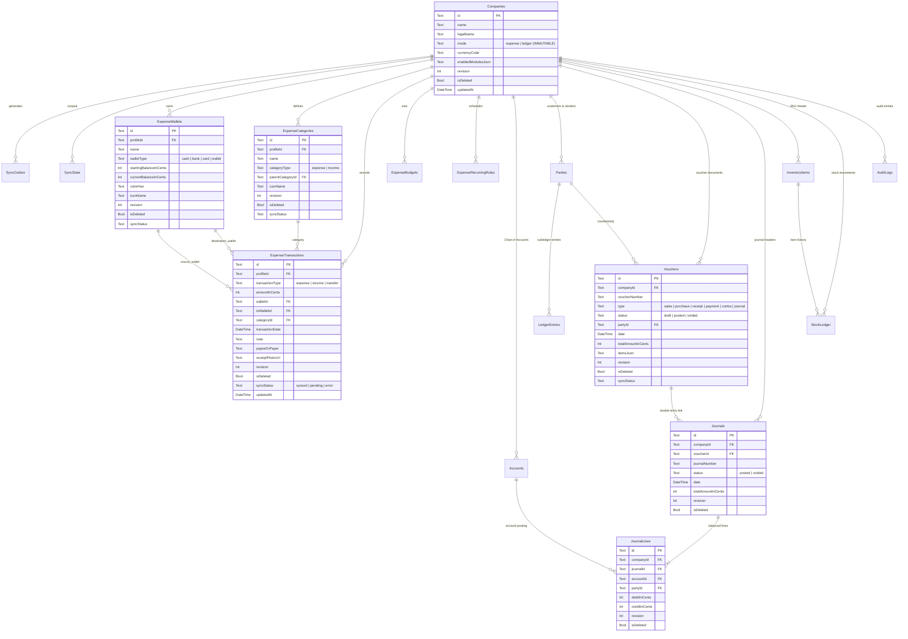

# Local Drift Database ERD Specification (SQLite / Drift)

**Contract Version:** `v1.0.0-PROD-CONTRACT-20261106`  
**Status:** Approved Architectural Target (Read-Only Specification)  
**Database Library:** Drift 2.34+ (Flutter / Dart)  
**Target Schema Version:** Drift Schema Version 11  

---

## 1. Local Database Architecture

The local SQLite database provides full offline-first functionality. Each physical user session is backed by a separate SQLite file:
`ledger_pulse_<sanitized_user_id>.sqlite` (or `usr_default`).

In Drift Schema Version 11, the database structure separates **Shared Infrastructure & Governance**, **Single-Entry Expense Storage**, and **Double-Entry Business Ledger Storage**.



---

## 2. Drift Table Inventory & Declarations (Schema v11)

### 2.1 Shared Governance & System Tables

#### 2.1.1 `Companies` (Retained Physical Table)
```dart
@DataClassName('CompanyTableData')
class Companies extends Table {
  TextColumn get id => text()();
  TextColumn get name => text()();
  TextColumn get legalName => text()();
  TextColumn get gstin => text().nullable()();
  TextColumn get stateCode => text().nullable()();
  TextColumn get dealerType => text().withDefault(const Constant('regular'))();
  TextColumn get currencyCode => text().withDefault(const Constant('INR'))();
  TextColumn get address => text().nullable()();
  TextColumn get email => text().nullable()();
  TextColumn get phoneNumber => text().nullable()();
  TextColumn get logoUrl => text().nullable()();
  TextColumn get signatureUrl => text().nullable()();
  TextColumn get signatoryName => text().nullable()();
  TextColumn get bankName => text().nullable()();
  TextColumn get bankAccountNumber => text().nullable()();
  TextColumn get bankIfsc => text().nullable()();
  TextColumn get upiId => text().nullable()();
  BoolColumn get isCloudSyncEnabled => boolean().withDefault(const Constant(true))();
  BoolColumn get isDropboxSyncEnabled => boolean().withDefault(const Constant(false))();
  BoolColumn get isActive => boolean().withDefault(const Constant(true))();
  TextColumn get mode => text().withDefault(const Constant('ledger'))(); // 'expense' or 'ledger'
  TextColumn get enabledModulesJson => text().nullable()();
  DateTimeColumn get createdAt => dateTime().withDefault(currentDateAndTime)();
  DateTimeColumn get updatedAt => dateTime().withDefault(currentDateAndTime)();
  BoolColumn get isDeleted => boolean().withDefault(const Constant(false))();
  TextColumn get syncStatus => textEnum<SyncRecordStatus>().withDefault(const Constant('synced'))();
  IntColumn get revision => integer().withDefault(const Constant(0))();
  DateTimeColumn get remoteUpdatedAt => dateTime().named('remote_updated_at').nullable()();
  TextColumn get ownerId => text().named('owner_id').nullable()();

  @override
  Set<Column> get primaryKey => {id};
}
```

#### 2.1.2 `SyncOutbox` & `SyncState`
```dart
@DataClassName('SyncOutboxTableData')
@TableIndex(name: 'sync_outbox_table_record_idx', columns: {#targetTable, #recordId}, unique: true)
class SyncOutbox extends Table {
  TextColumn get id => text()();
  TextColumn get targetTable => text().named('table_name')();
  TextColumn get recordId => text().named('record_id')();
  TextColumn get mutationType => text().named('mutation_type')(); // UPSERT, DELETE
  TextColumn get payload => text()();
  IntColumn get attempts => integer().withDefault(const Constant(0))();
  TextColumn get lastError => text().named('last_error').nullable()();
  DateTimeColumn get nextAttemptAt => dateTime().named('next_attempt_at').nullable()();
  DateTimeColumn get createdAt => dateTime().withDefault(currentDateAndTime)();

  @override
  Set<Column> get primaryKey => {id};
}

@DataClassName('SyncStateTableData')
class SyncState extends Table {
  TextColumn get targetTable => text().named('table_name')();
  TextColumn get companyId => text().named('company_id')();
  DateTimeColumn get lastPulledAt => dateTime().named('last_pulled_at').nullable()();

  @override
  Set<Column> get primaryKey => {targetTable, companyId};
}
```

---

### 2.2 Dedicated Expense Tracker Tables (New in v11)

#### 2.2.1 `ExpenseWallets`
```dart
@DataClassName('ExpenseWalletTableData')
@TableIndex(name: 'exp_wallets_profile_idx', columns: {#profileId})
class ExpenseWallets extends Table {
  TextColumn get id => text()();
  TextColumn get profileId => text().references(Companies, #id)();
  TextColumn get name => text()();
  TextColumn get walletType => text()(); // cash, bank, credit_card, digital_wallet, savings
  TextColumn get currencyCode => text().withDefault(const Constant('INR'))();
  IntColumn get startingBalanceInCents => integer().withDefault(const Constant(0))();
  IntColumn get currentBalanceInCents => integer().withDefault(const Constant(0))();
  TextColumn get colorHex => text().nullable()();
  TextColumn get iconName => text().nullable()();
  BoolColumn get isArchived => boolean().withDefault(const Constant(false))();
  DateTimeColumn get createdAt => dateTime().withDefault(currentDateAndTime)();
  DateTimeColumn get updatedAt => dateTime().withDefault(currentDateAndTime)();
  BoolColumn get isDeleted => boolean().withDefault(const Constant(false))();
  TextColumn get syncStatus => textEnum<SyncRecordStatus>().withDefault(const Constant('pending'))();
  IntColumn get revision => integer().withDefault(const Constant(0))();
  DateTimeColumn get remoteUpdatedAt => dateTime().named('remote_updated_at').nullable()();

  @override
  Set<Column> get primaryKey => {id};
}
```

#### 2.2.2 `ExpenseCategories`
```dart
@DataClassName('ExpenseCategoryTableData')
@TableIndex(name: 'exp_categories_profile_type_idx', columns: {#profileId, #categoryType})
class ExpenseCategories extends Table {
  TextColumn get id => text()();
  TextColumn get profileId => text().references(Companies, #id)();
  TextColumn get name => text()();
  TextColumn get categoryType => text()(); // expense, income
  TextColumn get parentCategoryId => text().nullable()();
  TextColumn get iconName => text().nullable()();
  TextColumn get colorHex => text().nullable()();
  BoolColumn get isSystem => boolean().withDefault(const Constant(false))();
  DateTimeColumn get createdAt => dateTime().withDefault(currentDateAndTime)();
  DateTimeColumn get updatedAt => dateTime().withDefault(currentDateAndTime)();
  BoolColumn get isDeleted => boolean().withDefault(const Constant(false))();
  TextColumn get syncStatus => textEnum<SyncRecordStatus>().withDefault(const Constant('pending'))();
  IntColumn get revision => integer().withDefault(const Constant(0))();
  DateTimeColumn get remoteUpdatedAt => dateTime().named('remote_updated_at').nullable()();

  @override
  Set<Column> get primaryKey => {id};
}
```

#### 2.2.3 `ExpenseTransactions`
```dart
@DataClassName('ExpenseTransactionTableData')
@TableIndex(name: 'exp_txns_profile_date_idx', columns: {#profileId, #transactionDate})
@TableIndex(name: 'exp_txns_wallet_idx', columns: {#walletId})
@TableIndex(name: 'exp_txns_category_idx', columns: {#categoryId})
class ExpenseTransactions extends Table {
  TextColumn get id => text()();
  TextColumn get profileId => text().references(Companies, #id)();
  TextColumn get transactionType => text()(); // expense, income, transfer
  IntColumn get amountInCents => integer()();
  TextColumn get walletId => text().references(ExpenseWallets, #id)();
  TextColumn get toWalletId => text().references(ExpenseWallets, #id).nullable()();
  TextColumn get categoryId => text().references(ExpenseCategories, #id).nullable()();
  DateTimeColumn get transactionDate => dateTime()();
  TextColumn get note => text().nullable()();
  TextColumn get payeeOrPayer => text().nullable()();
  TextColumn get referenceNumber => text().nullable()();
  TextColumn get receiptPhotoUrl => text().nullable()();
  BoolColumn get isCleared => boolean().withDefault(const Constant(true))();
  DateTimeColumn get createdAt => dateTime().withDefault(currentDateAndTime)();
  DateTimeColumn get updatedAt => dateTime().withDefault(currentDateAndTime)();
  BoolColumn get isDeleted => boolean().withDefault(const Constant(false))();
  TextColumn get syncStatus => textEnum<SyncRecordStatus>().withDefault(const Constant('pending'))();
  IntColumn get revision => integer().withDefault(const Constant(0))();
  DateTimeColumn get remoteUpdatedAt => dateTime().named('remote_updated_at').nullable()();

  @override
  Set<Column> get primaryKey => {id};
}
```

#### 2.2.4 `ExpenseBudgets` & `ExpenseRecurringRules`
- `ExpenseBudgets`: Maps directly to `exp_budgets`.
- `ExpenseRecurringRules`: Maps directly to `exp_recurring_rules`.

---

### 2.3 Business Ledger Tables (Preserved & Guarded)

All existing Ledger tables (`Accounts`, `Parties`, `LedgerEntries`, `Vouchers`, `Journals`, `JournalLines`, `InventoryItems`, `StockLedger`, `AuditLogs`) are preserved in full fidelity:

1. **`Vouchers`:** Retains composite indexes:
   - `vouchers_company_date_idx (companyId, date)`
   - `vouchers_company_type_status_idx (companyId, type, status)`
2. **`Journals` & `JournalLines`:** Retains composite indexes:
   - `journal_lines_journal_idx (journalId)`
   - `journal_lines_account_idx (accountId)`
3. **`Accounts`:** Retains unique index:
   - `accounts_company_code_idx (companyId, code) WHERE is_deleted = false`

---

## 3. Drift Migration Step (v10 to v11)

The upgrade from schema version 10 to 11 preserves all existing Ledger and Expense records by non-destructively copying existing Expense records into the new dedicated tables:

```dart
from10To11: (m, schema) async {
  // 1. Create new dedicated Expense tables
  await m.createTable(schema.expenseWallets);
  await m.createTable(schema.expenseCategories);
  await m.createTable(schema.expenseTransactions);
  await m.createTable(schema.expenseBudgets);
  await m.createTable(schema.expenseRecurringRules);

  // 2. Non-Destructive Backfill from legacy tables for profiles with mode = 'expenseTracker'
  // 2a. Backfill Wallets from Accounts (kind = 'wallet')
  await customStatement('''
    INSERT OR IGNORE INTO expense_wallets (
      id, profile_id, name, wallet_type, starting_balance_in_cents, current_balance_in_cents,
      created_at, updated_at, is_deleted, sync_status, revision
    )
    SELECT id, company_id, name, 'cash', 0, current_balance_in_cents,
           created_at, updated_at, is_deleted, sync_status, revision
    FROM accounts
    WHERE kind = 'wallet' AND is_deleted = 0;
  ''');

  // 2b. Backfill Categories from Accounts (kind = 'category')
  await customStatement('''
    INSERT OR IGNORE INTO expense_categories (
      id, profile_id, name, category_type, is_system,
      created_at, updated_at, is_deleted, sync_status, revision
    )
    SELECT id, company_id, name,
           CASE WHEN type = 'income' THEN 'income' ELSE 'expense' END,
           is_system, created_at, updated_at, is_deleted, sync_status, revision
    FROM accounts
    WHERE kind = 'category' AND is_deleted = 0;
  ''');

  // 2c. Backfill Transactions from Vouchers (types: 'expense', 'income', 'transfer')
  await customStatement('''
    INSERT OR IGNORE INTO expense_transactions (
      id, profile_id, transaction_type, amount_in_cents,
      wallet_id, to_wallet_id, category_id, transaction_date,
      note, reference_number, receipt_photo_url,
      created_at, updated_at, is_deleted, sync_status, revision
    )
    SELECT id, company_id, type, total_amount_in_cents,
           wallet_account_id, to_wallet_account_id, category_account_id, date,
           narration, reference_number, receipt_photo_url,
           created_at, updated_at, is_deleted, sync_status, revision
    FROM vouchers
    WHERE type IN ('expense', 'income', 'transfer') AND is_deleted = 0;
  ''');
}
```

---
*End of Local Drift Database ERD Specification (`docs/architecture/local-erd.md`)*

