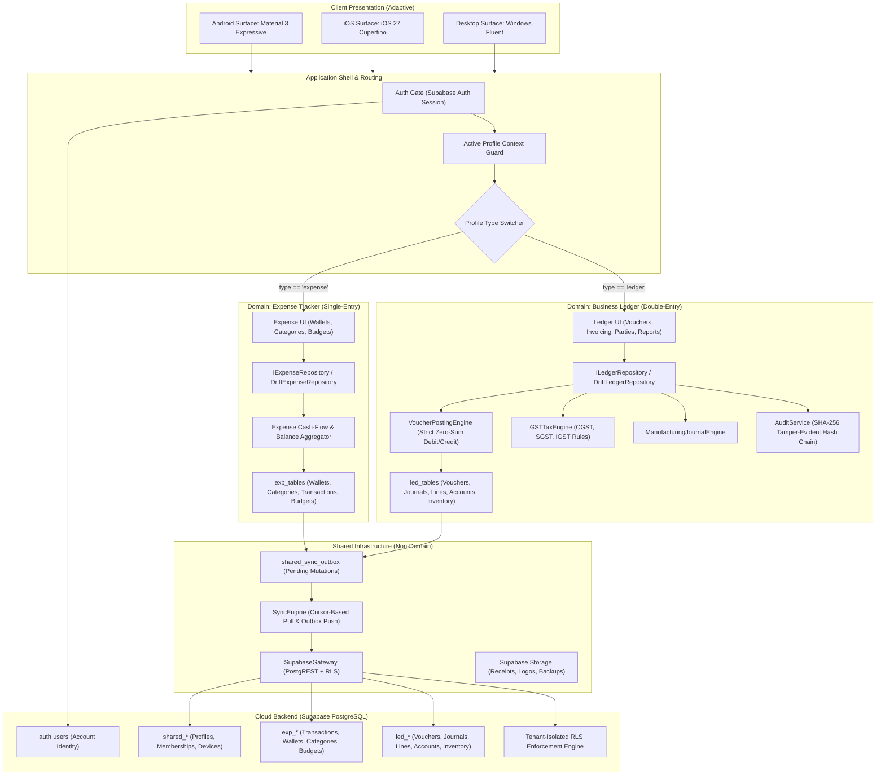

# LedgerPulse Target Architecture Specification

**Contract Version:** `v1.0.0-PROD-CONTRACT-20261106`  
**Status:** Approved Architectural Target (Read-Only Specification)  
**Author:** Principal Architect, LedgerPulse  
**Target Environments:** Android (Material 3 Expressive), iOS (iOS 27 Cupertino), Desktop (Windows), Web (LPWeb)  
**Storage Backends:** SQLite / Drift (Local Offline-First) & Supabase / PostgreSQL (Remote Cloud)

---

## 1. Domain Definitions & Terminology Disambiguation

To eliminate historical confusion between "user", "profile", "account", and "company", the architecture establishes six non-negotiable canonical concepts:

```
+-----------------------------------------------------------------------------------+
| 1. Account (auth.users)                                                           |
|    Globally unique authenticated identity (email/phone/password/OTP).             |
+-----------------------------------------------------------------------------------+
         | 1:1
         v
+-----------------------------------------------------------------------------------+
| 2. User Profile (shared_user_profiles)                                            |
|    Identity metadata (full name, avatar, global preferences, phone).              |
+-----------------------------------------------------------------------------------+
         | 1:N (via shared_memberships)
         v
+-----------------------------------------------------------------------------------+
| 4. Membership (shared_memberships)                                                |
|    Associates an Account with a Workspace Profile with an RBAC role.              |
+-----------------------------------------------------------------------------------+
         v N:1
+-----------------------------------------------------------------------------------+
| 3. Workspace Profile (shared_profiles / legacy table: companies)                  |
|    Isolated tenant / workspace. Type is IMMUTABLE: "expense" OR "ledger".         |
+-----------------------------------------------------------------------------------+
         ^
         | References currently active profile for session
+-----------------------------------------------------------------------------------+
| 5. Active Profile (Client Session State / Local SharedPreferences)                |
|    The workspace currently loaded in memory for the active user context.          |
+-----------------------------------------------------------------------------------+

+-----------------------------------------------------------------------------------+
| 6. Device (shared_devices)                                                        |
|    Physical hardware client (UUID, OS, app version) bound to Account & Sync State.|
+-----------------------------------------------------------------------------------+
```

### 1.1 Account
- **Definition:** The single authentication record maintained in Supabase `auth.users`.
- **Identity Key:** `account_id` (`UUID`, maps to `auth.uid()`).
- **Scope:** Credentials, JWT session tokens, multi-factor authentication, security stamps. An Account does not own accounting transactions directly; it accesses them via Memberships.

### 1.2 User Profile (`shared_user_profiles`)
- **Definition:** User-specific personal metadata tied 1:1 to an Account.
- **Identity Key:** `user_id` (`UUID`, primary key, equals `auth.users.id`).
- **Scope:** Display name, primary email, primary phone number, avatar URL, UI theme preferences, notification settings, and timestamp of account creation.

### 1.3 Workspace Profile (`shared_profiles` / legacy table `companies`)
- **Definition:** The autonomous tenant sandbox containing either personal expenses or business double-entry books.
- **Identity Key:** `profile_id` (`TEXT` / `UUID`, canonical primary key).
- **Physical Table Naming Policy:** In the remote database and local Drift schema, to guarantee zero data loss and eliminate migration risk, the existing physical table `companies` is retained and aliased conceptually as `shared_profiles`. A database view `shared_profiles` maps `companies` directly.
- **Profile Type:** **Strictly and permanently immutable upon creation.**
  - `expense`: Single-entry personal or freelance cash-flow tracker. Never touches double-entry ledgers, vouchers, or journals.
  - `ledger`: Full statutory double-entry accounting engine with GST, inventory, journals, audit trail, and financial statements.

### 1.4 Membership (`shared_memberships`)
- **Definition:** The relational binding between an Account and a Workspace Profile.
- **Cardinality:** An Account may have $N$ Memberships (accessing multiple profiles). A Workspace Profile may have $M$ Memberships (multi-user collaboration in Ledger mode).
- **Role Hierarchy:**
  - `owner`: Full administrative control, billing ownership, member management, profile deletion.
  - `admin`: Operational management, module configuration, user management (cannot delete profile or transfer ownership).
  - `accountant` (Ledger only): Full voucher and reporting access, audit trail viewing.
  - `manager` (Ledger only): Sales/purchase entry, inventory adjustments, party management.
  - `data_entry` (Ledger only): Voucher creation only, restricted reporting.
  - `viewer`: Read-only access to transactions and reports.

### 1.5 Active Profile
- **Definition:** The runtime state indicating which Workspace Profile is currently loaded into the UI, repository scope, and sync stream.
- **Storage:** Persisted locally in `SharedPreferences` as `last_active_profile_id_<account_id>`. Never stored as a shared column in cloud tables to avoid cross-device session thrashing.

### 1.6 Device (`shared_devices`)
- **Definition:** A unique physical hardware installation (Android phone, iPhone, iPad, Windows desktop).
- **Identity Key:** `device_id` (`UUID` generated on first run and stored in secure hardware storage / Keychain / Keystore).
- **Scope:** Device licensing quotas (Silver: 1, Gold: up to 3, Diamond: up to 5), push notification tokens, and local sync high-water mark tracking.

---

## 2. Canonical Naming & Formatting Freeze Contract

To prevent dialect drift across parallel teams, the following conventions are frozen for all implementation phases:

| Domain Element | Canonical Rule | Example |
| :--- | :--- | :--- |
| **Partition Identifier** | Always `profile_id` in domain models and API payloads; maps to `company_id` in legacy SQL columns. | `profile_id: "prf_01H..."` |
| **Primary Keys (Shared/Auth)**| Canonical RFC 4122 v4 UUID. | `a0eebc99-9c0b-4ef8-bb6d-6bb9bd380a11` |
| **Primary Keys (Entities)** | Prefixed ULID/KSUID or `v4` UUID with domain prefix. | `exp_01JBC...`, `vch_01JBC...` |
| **Table Prefixes** | Shared: `shared_` \| Expense: `exp_` \| Ledger: `led_` | `shared_profiles`, `exp_transactions`, `led_vouchers` |
| **Column Casing (Postgres)** | `snake_case` strictly. | `amount_in_cents`, `is_deleted`, `profile_id` |
| **Column Casing (Dart/Drift)**| `camelCase` in Dart models; Drift columns mapped explicitly via `.named('snake_case')`. | `amountInCents`, `isDeleted`, `profileId` |
| **Timestamps (Cloud)** | `TIMESTAMPTZ` (UTC ISO-8601 with timezone indicator `Z`). | `2026-11-06T07:33:00.000Z` |
| **Timestamps (Local Drift)** | `DateTimeColumn` stored as ISO-8601 text or Unix epoch milliseconds. | `DateTime.now().toUtc()` |
| **Money / Currency** | Fixed-point integer in minor currency units (`BIGINT` cents / paise). Zero float usage. | `₹1,250.50` stored as `125050` |
| **Quantities (Inventory)** | `NUMERIC(14, 4)` in PostgreSQL; `RealColumn` / `double` in Dart. | `15.7500` kg |
| **Soft Delete** | `is_deleted BOOLEAN NOT NULL DEFAULT FALSE` on all domain tables. | Hard deletes forbidden in standard flows. |
| **Concurrency & Revision** | `revision BIGINT NOT NULL DEFAULT 0` incremented on every update. | Guarded via Optimistic Concurrency Control (OCC). |

---

## 3. High-Level Target Architecture



---

## 4. Module Boundaries & Dependency Rules

To preserve clean architecture and ensure that Expense never depends on Ledger or vice-versa, the codebase strictly enforces the following dependency boundaries:

```
[Presentation: Expense]        [Presentation: Ledger]
         |                               |
         v                               v
   [Domain: Expense]               [Domain: Ledger]
         |                               |
         v                               v
    [Data: Expense]                 [Data: Ledger]
         \                             /
          \                           /
           v                         v
        [Shared Infrastructure: Sync, Auth, DB Connection, Storage]
                                     |
                                     v
                       [Core: Primitives, Themes, Utils]
```

### 4.1 Strict Dependency Invariants
1. **No Cross-Domain Imports:**  
   Code in `lib/data/expense/` or `lib/presentation/expense/` MUST NEVER import any symbol from `lib/data/ledger/`, `lib/data/accounting/`, or `lib/presentation/ledger/`.
2. **Double-Entry Isolation:**  
   `VoucherPostingEngine`, `Journals`, `JournalLines`, `Accounts` (ledger Chart of Accounts), and `GstTaxEngine` belong exclusively to the **Ledger domain**. Expense transactions must NEVER invoke `VoucherPostingEngine`.
3. **Shared Infrastructure:**  
   The sync outbox (`shared_sync_outbox`), network codecs, cryptographic utilities, theme engines, and Supabase client abstractions reside in `lib/core/` and `lib/shared/` and are domain-agnostic.
4. **Drift Database Modularity:**  
   The single local SQLite database contains tables partitioned by domain:
   - Shared: `shared_profiles`, `shared_user_profiles`, `shared_memberships`, `shared_sync_outbox`, `shared_sync_state`.
   - Expense: `exp_wallets`, `exp_categories`, `exp_transactions`, `exp_budgets`, `exp_recurring_rules`.
   - Ledger: `led_accounts`, `led_parties`, `led_vouchers`, `led_journals`, `led_journal_lines`, `led_inventory_items`, `led_stock_ledger`, `led_audit_logs`.

---

## 5. Storage Bucket & Path Authorization Contract

All file attachments (receipt images, company logos, digital signatures, exported PDF statements) are organized in Supabase Storage with strict tenant isolation matching database RLS:

### 5.1 Bucket Definition
- **Bucket ID:** `ledgerpulse_storage` (Private, public access disabled).

### 5.2 Storage Path Schema
```
ledgerpulse_storage/
├── profiles/
│   └── {profile_id}/
│       ├── branding/
│       │   ├── logo_{timestamp}.png
│       │   └── signature_{timestamp}.png
│       ├── receipts/
│       │   └── {year}/{month}/{transaction_or_voucher_id}_{uuid}.jpg
│       ├── exports/
│       │   └── {export_type}_{timestamp}.pdf
│       └── backups/
│           └── backup_{timestamp}.sqlite.enc
└── users/
    └── {account_id}/
        └── avatar/
            └── avatar_{timestamp}.jpg
```

### 5.3 Storage Access Rules
1. **User Avatars:** Read-write permitted only if `auth.uid() = {account_id}`.
2. **Profile Assets:** Read-write permitted only if the authenticated user has an active membership in `{profile_id}` with appropriate role permissions (Viewer: read-only; Data Entry/Manager/Admin/Owner: read-write).
3. **Encryption at Rest:** All receipt images and database backups stored remotely are encrypted using client-side or Supabase AES-256 standard encryption.

---

## 6. Target Architecture Document Map

The complete contract is divided into seven dedicated specifications:

| Deliverable File | Focus Area | Key Contents |
| :--- | :--- | :--- |
| **`target-architecture.md`** (This file) | System Core | Domain definitions, canonical freeze contract, module boundaries, storage rules. |
| **[`cloud-erd.md`](file:///c:/Programming/app/Ledger%20Pulse/docs/architecture/cloud-erd.md)** | Cloud Schema | Complete PostgreSQL cloud schema, foreign keys, constraints, and indexes. |
| **[`local-erd.md`](file:///c:/Programming/app/Ledger%20Pulse/docs/architecture/local-erd.md)** | Local Schema | Complete Drift local schema, SQLite indexes, table mapping, and foreign keys. |
| **[`data-dictionary.md`](file:///c:/Programming/app/Ledger%20Pulse/docs/architecture/data-dictionary.md)** | Field Contracts | Comprehensive column-level specification, types, precision, nullability, defaults. |
| **[`rls-matrix.md`](file:///c:/Programming/app/Ledger%20Pulse/docs/architecture/rls-matrix.md)** | Cloud Security | Exhaustive RLS policy matrix by table, operation, profile type, and role; emergency migration 0010. |
| **[`legacy-migration-map.md`](file:///c:/Programming/app/Ledger%20Pulse/docs/architecture/legacy-migration-map.md)** | Data Migration | Non-destructive transformation rules, legacy column mappings, and verification checks. |
| **[`implementation-sequence.md`](file:///c:/Programming/app/Ledger%20Pulse/docs/architecture/implementation-sequence.md)** | Phasing & Rollout | 8-phase execution roadmap, rollback plans, test baseline, and human approval gates. |

---
*Contract frozen. Proceed to companion documents for exact schemas and matrix definitions.*

